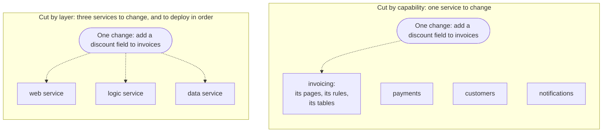

# 9.5 Service architecture

[Syllabus](../SYLLABUS.md) · Phase 9 · Previous: [9.4 Configuration and infrastructure as code](04-configuration-and-infrastructure.md) · Next: [9.6 Service-to-service communication](06-service-to-service-communication.md)

> **Time:** about 30 minutes to read, 40 minutes of practice.
> **You need:** the cost of a call that can fail, from [Chapter 6.1](../phase-6-reliability/01-how-distributed-systems-fail.md); data that is split between owners, from [Chapter 5.7](../phase-5-distributed-data/07-distributed-transactions.md); and compatible changes, from [Chapter 9.3](03-backward-compatibility.md). The example needs only Go, and takes about four seconds.

**By the end of this chapter you can**

- say what a boundary between services buys, and list what it costs;
- tell a monolith, a modular monolith, services and a distributed monolith apart;
- test whether a set of services is really separate, by asking whether each can be deployed alone;
- find where a boundary belongs, from the business, the data, the teams and the history of changes;
- say when a system should be split, and when it should not;
- split one gradually, and recognise when two parts should be put back together.

---

## The problem

*An illustrative scenario; the example reproduces its two measurements in miniature.* The invoicing product began as one application. At forty engineers, releases had become slow and tense, and the decision was taken to move to microservices. A year later there are thirty.

They are deployed together, on Thursdays, in an order that is kept in a document. A change to how a discount is stored touches the web service, the invoice service and the data service. It also touches the library of record types that all thirty are built with, so all thirty are built and shipped again. Creating an invoice makes twenty-four calls between services, takes nearly four times as long as it used to, and fails more often, because any one of the twenty-four can. There are thirty pipelines, thirty dashboards and one team on call for all of them.

The engineers have every cost of a distributed system and none of the benefits. Nothing can be deployed alone, so nothing was made independent. Three things went wrong.

1. **The system was cut along its layers,** and not along the things that the business does. Every feature crosses every layer.
2. **The parts still share:** a database, and a library with the business's record types in it. What is shared has to change together.
3. **Nobody asked what the split was for.** The trouble was forty people in one release. Thirty deployable things that are released together are still one release.

---

## The concept

### 1. What a boundary buys, and what it costs

A **service** is a part of the system that is built, deployed and run on its own, and reached over the network. Lewis and Fowler describe the microservice style as "an approach to developing a single application as a suite of small services, each running in its own process and communicating with lightweight mechanisms, often an HTTP resource API. These services are built around business capabilities and independently deployable by fully automated deployment machinery" ([James Lewis and Martin Fowler, *Microservices*](https://martinfowler.com/articles/microservices.html)).

The two phrases to hold on to are *business capabilities* and *independently deployable*. The scenario had neither.

| A boundary buys | And costs |
|---|---|
| A team can change and deploy its part without waiting for the others | Every call across it is a network call: slower, and able to fail (Phase 6) |
| A part can be scaled, or secured, differently from the rest | Data on the two sides cannot be joined, or changed in one transaction (Chapter 5.7) |
| A fault in one part need not take down the others | The interface is now an API that must stay compatible (Chapter 9.3) |
| A part can be rewritten without touching the rest | One more pipeline, dashboard, alert and rota (Phase 7 and this phase) |

The left column is about **people and change**. The right column is paid in **latency, failure and operations**. Fowler puts the right column in one sentence: "When you use microservices you have to work on automated deployment, monitoring, dealing with failure, eventual consistency, and other factors that a distributed system introduces" ([Martin Fowler, *MicroservicePremium*](https://martinfowler.com/bliki/MicroservicePremium.html)). His guideline follows from it: "don't even consider microservices unless you have a system that's too complex to manage as a monolith" (the same page).

A split is worth its price when something in the left column is a real problem today.

### 2. Four shapes

| Shape | Deployed as | Its parts are separated by | Fits |
|---|---|---|---|
| **Monolith** | One thing | Convention, if anything | A small team; a new product |
| **Modular monolith** | One thing | Boundaries in the code that are checked: a module's data is its own, and other modules use its interface | A growing product whose boundaries are still being found |
| **Services** | Several things, each on its own | The network, and separate data | Several teams whose work really is separate |
| **Distributed monolith** | Several things, together | The network, but not the data and not the release | Nobody. It is a split that failed |

The second row is the one that gets skipped. A modular monolith has the boundaries of a service design, with function calls where the network would be: no new ways to fail, one deploy, and transactions that still work. Shopify chose it in place of a split: "We chose to evolve Shopify into a modular monolith, meaning that we would keep all of the code in one codebase, but ensure that boundaries were defined and respected between different components" ([Kirsten Westeinde, Shopify Engineering, 2019](https://shopify.engineering/deconstructing-monolith-designing-software-maximizes-developer-productivity)).

It is also the safer road to services, because a boundary in the wrong place is cheap to move while it is a line in one codebase. Once it is an API between two teams, it is not: "Any refactoring of functionality between services is much harder than it is in a monolith. But even experienced architects working in familiar domains have great difficulty getting boundaries right at the beginning" ([Martin Fowler, *MonolithFirst*](https://martinfowler.com/bliki/MonolithFirst.html)). The same page reports what Fowler had seen: "Almost all the successful microservice stories have started with a monolith that got too big and was broken up."

His advice for the first two rows of the table: "The majority of software systems should be built as a single monolithic application. Do pay attention to good modularity within that monolith, but don't try to separate it into separate services" ([*MicroservicePremium*](https://martinfowler.com/bliki/MicroservicePremium.html)).

### 3. The test: can it be deployed alone?

One question tells services from a distributed monolith. *Can this part go to production on a Tuesday afternoon, with nobody from another team involved?*

It cannot, if any of these is true.

- **It shares a database table with another part.** A change to the table is then a change to both.
- **It shares a library that holds the business's rules or record types.** A change to the library is then a release of everything that is built with it.
- **Its interface changes incompatibly.** Its callers must then be deployed with it (Chapter 9.3).
- **A feature usually needs changes on both sides.** The boundary is then in the wrong place.

The last of these can be measured. Section 5 says how, and part 2 of the example does it.

### 4. Where a boundary belongs

**Along a business capability, and not along a technical layer.** Invoicing, payments, customers and notifications are things that the business does, and a change is usually about one of them. *The web layer*, *the logic* and *the data layer* are things that the code does, and a feature needs all three.



Domain-driven design has a name for an area with its own model and its own vocabulary, a **bounded context**, and a method for finding one; one line here, and a starting point in [Martin Fowler, *BoundedContext*](https://martinfowler.com/bliki/BoundedContext.html).

**Round the data that it owns.** A service is the only writer of its data, and the only reader of its tables. Everything else asks it. If two candidate services need the same rows in the same transaction, they are one service (Chapter 5.7).

**Round a team.** Conway observed in 1968 that "organizations which design systems (in the broad sense used here) are constrained to produce designs which are copies of the communication structures of these organizations" ([Melvin Conway, *How Do Committees Invent?*](https://www.melconway.com/Home/Committees_Paper.html)). It is now called Conway's law. A boundary between two services that one team owns buys nothing from the left column of section 1. A service that three teams share puts three teams in one release again.

**Where the rest of the course says so.** A part with a very different load (Chapter 9.7), a part that must be walled off for security (Chapter 8.1), a part whose failure must not spread (Chapter 6.3).

### 5. Measure it: what changes together

The history of the code already says where the boundaries are. Take the last few hundred changes. For each, list the parts that it touched. For any proposed cut, count the changes that would have needed more than one service to be deployed.

- If nearly every change stays inside one service, the cut follows the way the product really changes.
- If two services keep changing together, they are one service with a network call in the middle.
- If one thing is touched by every change, such as a shared library, it is not behind a boundary at all.

### 6. When to split, and how

**When.** Not at the start. The signs that a split would pay are the left column of section 1, as problems that have names: teams wait for each other to release; one part needs ten times the capacity of the rest; one part's faults keep taking the others down; one part's data needs a wall round it. Without one of those, the right column is paid for nothing.

**How.** A piece at a time, with the old system still running. Fowler named the approach after the strangler fig, a vine that grows on a tree until it can live without it. It makes "both investment and returns occur gradually and visibly" ([Martin Fowler, *StranglerFigApplication*](https://martinfowler.com/bliki/StranglerFigApplication.html)).

1. Draw the boundary inside the monolith first: a module with its own interface and its own tables.
2. Measure. Do changes stay inside it?
3. Put the module's data behind its interface, so that nothing else reads its tables. This is the hard step. It uses expand, migrate and contract (Chapter 9.3).
4. Only then move the module into its own process, behind the same interface.

Step 1 is cheap to undo. Step 4 is not.

---

## A real example

### Run it: the price of a boundary, and where to put one

[`code/ch05-boundaries/main.go`](code/ch05-boundaries/main.go) is about 245 lines. Part 1 makes real HTTP requests on your machine. One local server plays all five services, and half a millisecond is added to each call for the network inside a datacenter (Chapter 1.1). Failures are drawn, and not waited for. Part 2 is arithmetic on a list of twenty-four changes that is written out in the file.

```bash
go run ./phase-9-shipping/code/ch05-boundaries
```

```text
PART 1 — "create an invoice" takes five steps of 1 ms each. A call to another service adds half a
millisecond of network, and one call in a thousand fails.

  the same work, as                              calls over   time for one      requests that
                                                the network        request   fail, in 100,000
  one process: five function calls                        0         5.0 ms                106
  five services, called one after another                 5         8.1 ms                582
  …with pricing called once for each line                24        19.0 ms              2,420
  …with three of them asked at once                       5         4.9 ms                593
```

The work is the same in every row: five steps of a millisecond. Only its arrangement differs. The time is the median of 200 requests, and will differ a little on your machine.

- **Row 2** puts each step in a service. Five calls add 3.1 ms: half a millisecond of network each, and the work of making and answering an HTTP request. The request now needs six calls to succeed, its own and five more, where it needed one. So 582 requests in 100,000 fail where 106 did: between five and six times as many.
- **Row 3** is what happens when nobody looks. Pricing is asked about each of the twenty lines separately. That was a loop round a function in the monolith, and it is a loop round the network now. The request takes 3.8 times as long as the monolith's, and 2,420 in 100,000 fail. This is the N+1 query of Chapter 2.2, with services where the database was. A trace shows it at a glance (Chapter 7.4).
- **Row 4** asks the three services that do not depend on each other at once. The time is back to the monolith's, because the three waits overlap. The failures are not back: the request still needs every one of its calls.

So the price of a boundary depends on how it is used. A few coarse calls cost little. Many small ones cost a great deal. And no arrangement of calls makes the request more reliable than the function calls were.

```text
PART 2 — the last 24 changes to the product, and three ways of cutting it into services.

  the product is cut into                        changes that    …needed …needed three
                                                shipped alone        two      or more
  three services, one for each layer                        6         10            8
  four services, one for each capability                   19          5            0
  …that share one library of record types                  14          2            8
```

**Row 1 is the scenario's cut.** Of twenty-four changes, six could be shipped by deploying one service. The other eighteen needed two or three, in the right order.

**Row 2 cuts by capability.** Nineteen of the twenty-four ship alone. The five that do not are real: *mark an invoice paid when money arrives* is about payments and about invoicing. Changes like it show where the interfaces between the services are, and there are few enough of them to design each with care.

**Row 3 is row 2 with one thing shared.** The four services are built with a common library of record types. Eight of the changes altered a record, and each of those is now a release of all four services. A good cut has become a distributed monolith, by way of one shared package.

The rule that does it is three lines:

```go
		if c.models { // every service is built with the library, so every service ships again
			return []string{"invoicing", "payments", "customers", "notifications"}
		}
```

### How Segment went back: from over 140 services to one

Segment forwards its customers' events to other companies' tools, which it calls destinations: "There are over one hundred types of these destinations". When one slow destination held up the queue for all of them, "the team created a separate service and queue for each destination" ([Alexandra Noonan, *Goodbye Microservices: From 100s of problem children to 1 superstar*, Twilio Segment, 2018](https://www.twilio.com/en-us/blog/developers/best-practices/goodbye-microservices)). The account of what followed is frank.

| What happened | In the article's words ([the same article](https://www.twilio.com/en-us/blog/developers/best-practices/goodbye-microservices)) |
|---|---|
| The split solved the first problem | "Our initial microservice architecture worked for a time, solving the immediate performance issues in our pipeline by isolating the destinations from each other" |
| The cost grew with the count | "With our microservice architecture, our operational overhead increased linearly with each added destination" |
| The services shared libraries, and the sharing coupled them | "Testing and deploying changes to these shared libraries impacted all of our destinations" |
| So the libraries stopped improving | "Making changes to improve our libraries, knowing we'd have to test and deploy dozens of services, was a risky proposition" |
| The people ran out | "3 full-time engineers spending most of their time just keeping the system alive" |
| They merged | "The first item on the list was to consolidate the now over 140 services into a single service" |
| Change became cheaper | "When our microservice architecture was still in place, we made 32 improvements to our shared libraries. One year later, we've made 46 improvements" |
| And something was given up | "Fault isolation is difficult. With everything running in a monolith, if a bug is introduced in one destination that causes the service to crash, the service will crash for all destinations" |

The third row of that table is row 3 of part 2. The last row is the third line of the table in section 1, handed back.

The lesson is not that services are wrong. The destinations were separate things, and separating them had worked. But the article calls the owners "the small team" ([the same article](https://www.twilio.com/en-us/blog/developers/best-practices/goodbye-microservices)). One team owned every service, so the boundaries bought no independence between teams, and the team paid for 140 of everything.

---

## Trade-offs

**Independence against simplicity.** Every boundary makes somebody independent, and makes the whole harder to run and to reason about. Count the teams. Services in numbers far beyond the teams that own them are a cost with nobody to benefit.

**A modular monolith against real isolation.** Modules in one process share its memory, its CPU and its crashes. When one part must not be able to take the others down, or must scale alone, a module is not enough. Segment gave up exactly that, and said so.

**Sharing code against coupling.** Code that every service is built with has to be released into every service. Segment's libraries held nothing stranger than common transforms and HTTP request handling, and a change to them still meant dozens of deploys. A shared library is safe only while each service can stay on an old version of it for as long as it likes. A library of the business's record types is the worst case, because a new field is of no use until every service has it. Prefer a little duplication at a boundary to a shared model across it.

**Sharing data against duplication.** One table that two services read is simple, and couples them. Each service keeping its own copy of what it needs, fed by events (Chapter 4.7), is independent, and eventually consistent (Chapter 5.4).

**Getting the boundaries right first against learning them.** A new product's boundaries are not known yet. They show themselves in how it changes. That is the case for the monolith first: it keeps the lines cheap to move while you find out where they are.

---

## Practice

### Check yourself

1. Two services are owned by two teams and have separate pipelines. Every Thursday they are deployed together, in a fixed order. Name three things that could make that necessary, and say how you would find out which it is.
2. A team of six proposes to split its application into eight services, *so that it can scale*. What do you ask?
3. In part 1, asking three services at once brought the time back to the monolith's. Why did the failures not come back with it?

<details>
<summary>Answers</summary>

1. They share a table, so that a change to its shape needs both. Or one calls the other and the interface is changed incompatibly, so that caller and callee have to move at once. Or both are built with a shared library of record types. To find out, look at the last twenty joint releases, and for each ask which change forced the pair. One cause will account for nearly all of them.
2. Which part needs to scale, and by how much more than the rest? One application can be run as many copies (Chapter 3.1), so scale alone is seldom a reason to split. Then: with six people, who will own eight pipelines and eight sets of alerts? If one part really does carry ten times the load, split that one part out, and keep the rest together.
3. Time adds up along a chain, and calls that are made at once overlap, so only the slowest of the three counts. Failure does not overlap: the request needs all of its calls to succeed, in whatever order they are made. The ways to fail less are to make fewer calls, to make each call more reliable (Chapter 6.2), or to stop needing some of them for the answer.

</details>

### Exercise: take a call out, and judge a boundary

1. **Predict, then run.** In part 1, the notification does not have to be sent before the caller is answered. Add a fifth shape: the three checks are made at once, the ledger is called, and the notification is left on a queue. Predict the time and the failures.
2. **Judge the cut.** In part 2's list, which pairs of capabilities change together? Is there a pair that should be one service?
3. **Advise the scenario's team.** Forty engineers, thirty services cut by layer, a shared library of record types, and one release a week. What do you do first, and what do you not do?

<details>
<summary>Worked solution</summary>

**1.** The notification's call is no longer part of the request. The new shape is the fourth one without its last line:

```go
		{"…and the notification left on a queue", 4, func(svc string) {
			var wg sync.WaitGroup
			for _, s := range []string{"customer", "pricing", "tax"} {
				wg.Add(1)
				go func() {
					defer wg.Done()
					call(svc + "/" + s)
				}()
			}
			wg.Wait()
			call(svc + "/ledger") // the ledger writes the invoice and the message together (Chapter 4.5)
		}},
```

The last two rows of the table are now:

```text
  …with three of them asked at once                       5         4.9 ms                593
  …and the notification left on a queue                   4         3.3 ms                478
```

One round of three calls made at once, and then the ledger: the time of two calls, 3.3 ms against 4.9 ms. The request has five chances to fail where it had six, so in the long run about a sixth fewer requests fail. This run drew 478 against 593.

It fails less for one reason: it needs fewer calls to succeed before it answers. The notification can still fail. It fails later, on a queue that tries it again (Chapter 4.2), and the caller never knows. That is safe only if the invoice and the message for the queue are written together (Chapter 4.5).

**2.** Five changes name two capabilities, and no pair appears twice: payments with invoicing, customers with invoicing, notifications with customers, notifications with payments, customers with payments. No two of the four change together often enough to be one service, so the cut by capability is a good one for this history. If *payments+invoicing* had appeared eight times, the answer would be to merge those two, and to say so plainly.

**3.** First, stop paying for the shared library. Give each service its own copy of the few record types that it uses, and let the copies differ. That alone ends the releases of everything.

Second, do not add services. Merge them. The layers of each capability always change together, so they become one service for each capability: four or five services, each owned by a team of eight to ten people. Do the merge inside one codebase first if that is easier. A modular monolith with four modules is a better place to stand than thirty services.

Third, find out whether the original trouble has gone. Forty people in one release is cured by four teams that can each deploy alone. That needs four deployable things, and not thirty.

What not to do: a second rewrite, into a different thirty.

</details>

---

## Production tips and common mistakes

- **Start with one deployable thing,** and keep the modules inside it honest: no module reaches into another's tables.
- **Split for a reason that has a name:** a team that waits, a part that scales differently, a fault that must not spread, data that needs a wall.
- **Cut by what the business does,** and give each service its own data.
- **Ask of every service whether it can be deployed alone.** If it cannot, find what it shares.
- **Count the changes that crossed a boundary** before choosing it, and again a year after.
- **Keep the calls across a boundary few and coarse.** Watch the number of calls in one request (Chapter 7.4).
- **Do not share the business's types in a library.** Publish an interface (Chapter 9.3), and let each service keep its own types.
- **Match services to teams.** A service has one owning team, and a team has few services.
- **Merge services that always change together.** Putting two back is not a failure.
- **Move a module's data before its code.**
- **Keep the repository out of the argument.** One repository or many is a separate decision from one deployable thing or many.

Common mistakes:

- **Services cut by layer.**
- **Several services and one database.**
- **A shared library of the business's types.**
- **Thirty services, deployed together on Thursdays.**
- **A split to cure tangled code,** which moves the tangle onto the network.
- **More services than engineers.**
- **A loop of network calls where there was a loop of function calls.**
- **A boundary drawn before anyone knew how the product would change.**

---

## Key takeaways

- A boundary between services buys independence for the people who change the system. It is paid for in latency, in failure and in operations.
- Services that cannot be deployed alone are a distributed monolith: every cost, and no benefit. Look for a shared table or a shared library of the business's types.
- A modular monolith gives the boundaries without the network, and keeps them cheap to move. Start there, and stay until there is a reason to leave.
- Draw boundaries round business capabilities, round data with one owner, and round teams. Check them against the history: a change should stay inside one service.
- Split for a reason that has a name, one piece at a time, data first. Merge when two parts always change together.

**Next:** [9.6 Service-to-service communication](06-service-to-service-communication.md) — once there are several services, each has to find the others, call them, and survive them. Doing that separately in every codebase is the next thing that goes wrong.

---

## Sources

- James Lewis and Martin Fowler, [*Microservices*](https://martinfowler.com/articles/microservices.html), 2014.
- Martin Fowler: [*MicroservicePremium*](https://martinfowler.com/bliki/MicroservicePremium.html); [*MonolithFirst*](https://martinfowler.com/bliki/MonolithFirst.html), 2015; [*StranglerFigApplication*](https://martinfowler.com/bliki/StranglerFigApplication.html); [*BoundedContext*](https://martinfowler.com/bliki/BoundedContext.html), 2014.
- Kirsten Westeinde, [*Deconstructing the Monolith: Designing Software that Maximizes Developer Productivity*](https://shopify.engineering/deconstructing-monolith-designing-software-maximizes-developer-productivity), Shopify Engineering, 2019.
- Melvin E. Conway, [*How Do Committees Invent?*](https://www.melconway.com/Home/Committees_Paper.html), 1968.
- Alexandra Noonan, [*Goodbye Microservices: From 100s of problem children to 1 superstar*](https://www.twilio.com/en-us/blog/developers/best-practices/goodbye-microservices), Twilio Segment, 2018.
