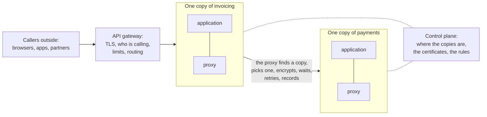

# 9.6 Service-to-service communication

[Syllabus](../SYLLABUS.md) · Phase 9 · Previous: [9.5 Service architecture](05-service-architecture.md) · Next: [9.7 Capacity planning and autoscaling](07-capacity-planning-and-autoscaling.md)

> **Time:** about 35 minutes to read, 40 minutes of practice.
> **You need:** retries and idempotency keys from [Chapter 1.5](../phase-1-foundations/05-timeouts-retries-idempotency.md), balancing requests and not connections from [Chapter 3.2](../phase-3-scaling-out/02-load-balancing.md), and the copy that drains before it stops from [Chapter 9.1](01-containers-and-orchestration.md). The example needs only Go, and takes about four seconds.

**By the end of this chapter you can**

- list the five questions that every call between services has to answer;
- explain how a caller finds a service whose copies come and go, and what goes wrong when its knowledge is out of date;
- choose between gRPC and JSON over HTTP for an interface, and give the reasons;
- say what an API gateway is for, and what must stay out of it;
- describe a service mesh: its proxies, its control plane, what it takes out of application code, and what it cannot;
- decide where each rule about calls should live: in the code, in a shared library, or in a proxy.

---

## The problem

*An illustrative scenario; the example reproduces both of its failures.* The invoicing product of the last chapter has forty services now, and they call each other.

**The first failure is an address.** Each service keeps the hostnames of the services that it calls in its configuration file. On Tuesday the payments service is moved to new machines. Thirty-four services are updated. Six are not, because nobody knew that they called payments. They fail until somebody finds the line.

**The second is a retry.** Three years ago an engineer wrote a careful helper for calling another service: a timeout, and three tries. It was copied into every new service. There are forty copies now, in nine versions. Some wait between tries and some do not. One team taught its copy to retry `POST`. On Thursday a copy of payments begins to lose its answers, and that team's service charges 167 customers twice.

The fix to the helper is ten lines. It takes seven weeks to reach forty codebases, because it is forty changes, forty reviews and forty deploys.

Three things are wrong.

1. **Callers know addresses.** An address is a fact about this week's machines. What a caller should know is a name.
2. **Every codebase answers the same questions for itself:** where the service is, how long to wait, when to try again. The answers drift apart.
3. **There is no one place to change them.** A rule that lives in forty codebases cannot be changed in an afternoon, and an afternoon is all there is during an incident.

---

## The concept

### 1. Five questions for every call

A call from one service to another has to answer five questions. Earlier chapters answered each of them for one caller. This chapter is about answering them for forty.

| The question | The answer | Where it was taught |
|---|---|---|
| Where is the service? | Discovery: a name, and something that knows its addresses | Here |
| Which copy gets this request? | Load balancing, of each request | Chapter 3.2 |
| How long do I wait, and do I try again? | Deadlines, retries with a budget, circuit breakers | Chapters 1.5, 6.2 and 6.3 |
| Who is calling, and may they? | Mutual TLS, and authorization | Chapters 8.3 and 8.4 |
| What happened? | Metrics, logs and traces of the call | Chapters 7.1 and 7.4 |

None of the five is about invoices or payments. Everything below depends on that. The answers are the same for every service, so they do not have to be written by every team.

### 2. Where is it? A name, and something that knows

Kubernetes' documentation states the problem. Copies are created and destroyed, each with an address of its own, so "how do the frontends find out and keep track of which IP address to connect to" ([Kubernetes documentation, *Service*](https://kubernetes.io/docs/concepts/services-networking/service/))?

The answer has two parts.

**A name.** A caller is given the name of a service, and never an address: "Service discovery uses a service's identity instead of traditional access information (IP address and port)" ([Consul documentation, *Service discovery*](https://developer.hashicorp.com/consul/docs/use-case/service-discovery)). In Kubernetes the name is a DNS name: "You can contact Services with consistent DNS names instead of IP addresses" ([Kubernetes documentation, *DNS for Services and Pods*](https://kubernetes.io/docs/concepts/services-networking/dns-pod-service/)).

**A registry:** something that knows which addresses answer to the name at this moment. A copy is added when it is ready, and removed when it leaves (Chapter 9.1). A copy can also die without saying so, and so the registry has to check: by a health check that it makes, or by a heartbeat that the copy must keep sending.

There are two places to put the lookup.

| | The caller looks up | Something in between looks up |
|---|---|---|
| How | The caller asks the registry for the addresses, and picks one | The caller sends to one stable address, and a balancer or proxy there knows the copies |
| Usual name | Client-side discovery | Server-side discovery |
| In Kubernetes | A headless Service: the name gives the addresses of the copies | An ordinary Service: one virtual address for the name |
| For | No extra hop, and the caller can balance each request | The caller needs to know nothing |
| Against | Every caller needs the code, in every language | One more thing in the path, and it must balance requests and not connections (Chapter 3.2) |

The two names are Chris Richardson's ([*Client-side service discovery*](https://microservices.io/patterns/client-side-discovery.html), [*Server-side service discovery*](https://microservices.io/patterns/server-side-discovery.html)). The Kubernetes row is from its documentation: "A headless Service allows a client to connect to whichever Pod it prefers, directly" ([*Service*](https://kubernetes.io/docs/concepts/services-networking/service/)).

**What a caller knows is always a little old.** This is the part that goes wrong, in three ways.

- **Looked up once.** A caller that resolves a name when it starts, and keeps the answer, has a hard-coded address that takes longer to fail. It is a real default: "On some Java configurations, the JVM default TTL is set so that it will never refresh DNS entries until the JVM is restarted" ([AWS SDK for Java documentation, *Set the JVM TTL for DNS name lookups*](https://docs.aws.amazon.com/sdk-for-java/latest/developer-guide/jvm-ttl-dns.html)).
- **Looked up again, but late.** A caller that asks again every so often is out of date for up to that long. So a copy that is leaving must go on serving for longer than callers take to hear of it. This is the drain of Chapter 9.1, and now there is a number to compare it with.
- **Dead, and still listed.** A copy that dies stays listed until the registry notices. So a caller must expect that some of the addresses it is given are dead, and try another. A connection that was refused carried no request, and so trying another copy after one is always safe.

### 3. What do the two sides say? gRPC, or JSON over HTTP

Chapter 1.3 promised this comparison. Between your own services there are two usual choices.

**JSON over HTTP** is what Phase 1 taught: resources, methods and status codes, with bodies that a person can read.

**gRPC** starts from a contract. The service and its messages are declared in a file, in the Protocol Buffers language. A sketch, which this repository does not compile:

```proto
service Invoices {
  rpc GetInvoice(GetInvoiceRequest) returns (Invoice);
  rpc WatchPayments(WatchRequest) returns (stream Payment);
}
```

A tool turns the file into code for the caller and for the service, in each language. After that, "a client application can directly call a method on a server application on a different machine as if it were a local object" ([gRPC documentation, *Introduction to gRPC*](https://grpc.io/docs/what-is-grpc/introduction/)). Underneath, each call is an HTTP/2 request (Chapter 1.3), and the messages are binary. Protocol Buffers is "like JSON, except it's smaller and faster, and it generates native language bindings" ([Protocol Buffers documentation, *Overview*](https://protobuf.dev/overview/)).

| | gRPC | JSON over HTTP |
|---|---|---|
| The contract | A `.proto` file, from which callers and services are generated | Optional: an [OpenAPI](https://www.openapis.org/what-is-openapi) description, if the team keeps it true |
| On the wire | Binary, over HTTP/2 | Text, over any version of HTTP |
| Calls that stream | Built in, in either direction or both | Separate machinery: server-sent events or WebSockets (Chapter 3.7) |
| Deadlines | Part of every call, and passed on (Chapter 6.2) | A header that you define, and pass on yourself |
| Reading a request by eye | Needs the `.proto` file and a tool | `curl` |
| A browser as the caller | Not directly: a translating proxy is needed | Yes |
| Changing the interface | The rules of Chapter 9.3, with field numbers | The rules of Chapters 1.4 and 9.3 |
| Load balancing | One long-lived connection, so requests must be balanced and not connections (Chapter 3.2) | Either kind works |

Three of those rows in the projects' own words. On streaming: "gRPC lets you define four kinds of service method" ([gRPC documentation, *Core concepts*](https://grpc.io/docs/what-is-grpc/core-concepts/)): one request and one answer, a stream in either direction, or a stream in both. On reading: of a Protocol Buffers message, "you cannot fully interpret one without access to its corresponding .proto file" ([Protocol Buffers documentation, *Overview*](https://protobuf.dev/overview/)). On browsers: "there is simply no browser API with enough fine-grained control over the requests" ([gRPC blog, *The state of gRPC in the browser*](https://grpc.io/blog/state-of-grpc-web/)).

**Choosing.** Use gRPC for calls between services that you own, in several languages, where the contract and the generated code repay the tooling. Use JSON over HTTP for an API that other people call, for browsers, and wherever being able to read the traffic matters more. The two can be combined: JSON over HTTP at the edge, and gRPC inside.

**Neither removes the network.** *As if it were a local object* describes how the call is written. The call can still be slow, fail, or succeed without its answer arriving (Chapter 1.5). gRPC's designers list the aim of "avoiding the pitfalls of distributed objects and the fallacies of ignoring the network" among their principles ([gRPC blog, *gRPC Motivation and Design Principles*](https://grpc.io/blog/principles/)).

### 4. Where do the answers live? Three places

The five answers of section 1 can be written in three places.

**In each codebase.** This is the scenario: forty copies, in nine versions.

**In one library that every service must use.** Large companies did this first. "Netflix had Hystrix, Google had the Stubby libraries, and Twitter had Finagle. Finagle, for example, was mandatory for every new service at Twitter, handled both client and server sides of the connection, and implemented retries, and request routing, and load balancing, and instrumentation" ([Buoyant, *What is a Service Mesh?*](https://www.buoyant.io/what-is-a-service-mesh)). gRPC came out of Google's: "Having a uniform, cross-platform RPC infrastructure has allowed for the rollout of fleet-wide improvements in efficiency, security, reliability and behavioral analysis" ([gRPC blog, *gRPC Motivation and Design Principles*](https://grpc.io/blog/principles/)).

A library is fast, because it adds no hop. Its costs are the ones that Chapter 9.5 found in Segment's shared libraries. It has to exist in every language that the company uses, and a fix reaches a service only when that service is built and deployed again.

**In a proxy beside each service.** The third place is outside the program. Each copy of each service is given a small proxy of its own, called a **sidecar**. The application sends its calls to the proxy on its own machine, and the proxy does the rest. Envoy is such a proxy, and its documentation gives the two reasons: "Envoy works with any application language", and "deploying library upgrades can be incredibly painful. Envoy can be deployed and upgraded quickly across an entire infrastructure transparently" ([Envoy documentation, *What is Envoy*](https://www.envoyproxy.io/docs/envoy/latest/intro/what_is_envoy)).

All the proxies, together with the thing that configures them, are a **service mesh**.



- The proxies are the **data plane**. In Istio, "These proxies mediate and control all network communication between microservices. They also collect and report telemetry on all mesh traffic" ([Istio documentation, *Architecture*](https://istio.io/latest/docs/ops/deployment/architecture/)).
- The **control plane** tells them what to do: where each service's copies are, which certificates to present, and the rules. "The control plane manages and configures the proxies to route traffic" (the same page).

So a mesh answers the five questions in one place: discovery, balancing of each request, timeouts and retries, mutual TLS between every pair of services (Chapter 8.4), and the same measurements of every call. Istio's summary is that an application gets these "without code changes" ([Istio, *The Istio service mesh*](https://istio.io/latest/about/service-mesh/)). A change to a rule is a change to the control plane's configuration. It reaches every call, and so it is delivered in stages, like any configuration (Chapter 9.4).

The gateway on the left of the diagram is the subject of section 6.

### 5. What a proxy cannot know

A proxy sees requests. It does not know what they mean.

**It cannot know whether a request may be sent twice.** Linkerd's documentation is plain about it: "automatically retrying a request that changes system state each time it is called can be disastrous. Thus, retries should only be used on idempotent methods" ([Linkerd documentation, *Retries and Timeouts*](https://linkerd.io/docs/features/retries-and-timeouts/)).

That matters, because a mesh may retry without being asked. In Istio, "The default retry behavior for HTTP requests is to retry twice before returning the error" ([Istio documentation, *Traffic Management*](https://istio.io/latest/docs/concepts/traffic-management/)). Its default conditions are cautious ones, such as a connection that could not be made ([Istio reference, *Virtual Service*](https://istio.io/latest/docs/reference/config/networking/virtual-service/)). Widen them, and the proxy repeats whatever it is allowed to.

A request can tell a proxy that a repeat is safe, in two ways (Chapters 1.3 and 1.5): by a method that HTTP defines as idempotent, or by an idempotency key that the service honours. Go's own HTTP client looks for the same two signs before it repeats a request on a connection that broke: "Transport only retries a request upon encountering a network error if the connection has already been used successfully and if the request is idempotent and either has no body or has its Request.GetBody defined" ([Go, `net/http`](https://pkg.go.dev/net/http#Transport)). The same paragraph says what counts as idempotent: one of four methods, or a header named `Idempotency-Key`.

**It cannot decide what to do instead.** Buoyant makes a mesh, and says so: "it can't make decisions about what to return to the user if a service is entirely down—the application must make these decisions" ([Buoyant, *What is a Service Mesh?*](https://www.buoyant.io/what-is-a-service-mesh)). The fallback of Chapter 6.3 is business logic.

**It cannot see inside.** A proxy reports the time and the status of each call. It cannot join the calls into a trace without help: "Applications must propagate this information in HTTP headers, so that when proxies send spans, the backend can join them together into a single trace" ([Istio documentation, *Distributed tracing: overview*](https://istio.io/latest/docs/tasks/observability/distributed-tracing/overview/)). The same is true of a deadline (Chapter 6.2). What arrives with a request has to be passed on by the code that makes the next one.

### 6. The front door: an API gateway

Calls from outside are a different problem from calls inside, and they have a tool of their own. An **API gateway** is the one place where outside callers come in. "It acts as a reverse proxy and routes clients requests to the appropriate services. It can also perform various cross-cutting tasks such as authentication, SSL termination, mutual TLS, and rate limiting" ([Azure Architecture Center, *Use API gateways in microservices*](https://learn.microsoft.com/en-us/azure/architecture/microservices/design/gateway)).

What belongs in it is what is true of every outside request, whatever the request is for:

- ending TLS, and establishing who the caller is (Chapter 8.2);
- a limit for each caller (Chapters 6.4 and 8.6);
- sending each path to the service that owns it, so that outsiders see one API and not forty;
- one place where what comes in is counted and logged.

What does not belong in it: "Never offload business logic to the gateway" ([Azure Architecture Center, *Gateway Offloading pattern*](https://learn.microsoft.com/en-us/azure/architecture/patterns/gateway-offloading)). A gateway that knows what an invoice is has become a service that every team must change, and that is the shared release of Chapter 9.5 again. Whether this caller may see this invoice is still decided by the service that owns the invoice (Chapter 8.3).

Two more things follow from its position. Every outside request passes through it, and "The gateway adds a network hop to every request" ([*Gateway Offloading pattern*](https://learn.microsoft.com/en-us/azure/architecture/patterns/gateway-offloading)), so it has to be at least as available and as fast as the product is meant to be (Chapter 6.5). And when a web page and a mobile app need answers of different shapes, the established pattern is a small backend for each: "Create a separate backend service for each frontend interface, instead of using a single general-purpose backend for all of them" ([Azure Architecture Center, *Backends for Frontends pattern*](https://learn.microsoft.com/en-us/azure/architecture/patterns/backends-for-frontends)).

Traffic that crosses the edge is called *north–south*, and traffic between services *east–west*. A gateway is for the first, and a mesh for the second.

---

## A real example

### Run it: finding a service, and one rule for forty callers

[`code/ch06-calls`](code/ch06-calls/) is three files and about 470 lines. [`discovery.go`](code/ch06-calls/discovery.go) is part 1, and [`proxy.go`](code/ch06-calls/proxy.go) is part 2. Every request is real HTTP between servers that the program starts on your own machine. The registry and the control plane are objects inside the program, where a real system would run each as a service.

```bash
go run ./phase-9-shipping/code/ch06-calls
```

```text
PART 1 — "orders" runs as three copies. A caller sends it 3,000 requests, one each millisecond.
Meanwhile each copy is replaced by one at a new address, and then one copy dies without a word.

  how the caller finds a copy                         failed while the copies     failed after one
                                                      were replaced, of 1,800  copy died, of 1,200
  an address written in its configuration                               1,330                1,200
  the name, looked up once when it started                                929                1,200
  the name, looked up again every 100 ms                                    0                  106
  …and another copy tried when one does not answer                          0                    0
```

A copy tells the registry that it is alive every 50 ms, and the registry believes a copy for 300 ms after it last heard from it. A copy that leaves on purpose says so, and goes on serving for 150 ms.

- **Row 1 is the scenario's Tuesday.** The address in the configuration was right until that copy was replaced, and wrong ever after.
- **Row 2 looks better, and is the same mistake.** The caller asked the registry, once. Its three addresses went out of date one at a time, and then it failed completely too. This is the JVM default of section 2.
- **Row 3 asks again every 100 ms.** The deploy costs nothing, because 150 ms of draining is longer than 100 ms of not knowing. The death is different. The registry goes on listing the dead copy until its heartbeats have been missing for 300 ms, and for that long a third of this caller's requests go to an address where nothing listens: 106 failures.
- **Row 4 adds one rule:** if a copy does not answer, try the next. Nothing fails.

The whole of a caller's knowledge is in one function:

```go
// order returns the copies to try for the next request: one first, and then the others.
func (c *caller) order(reg *registry) []string {
	if c.refresh > 0 && time.Since(c.asked) >= c.refresh {
		c.addrs, c.asked = reg.lookup(), time.Now()
	}
	c.next++
	out := make([]string, 0, len(c.addrs))
	for i := range c.addrs {
		out = append(out, c.addrs[(c.next+i)%len(c.addrs)])
	}
	if !c.retry && len(out) > 1 {
		out = out[:1]
	}
	return out
}
```

Row 4's retry was safe for two reasons. A refused connection carried no request. And the requests were `GET`s. Part 2 is about the failures where neither is true.

```text
PART 2 — "payments" has three copies. One does the work, and then loses one answer in three.
Forty callers make 1,500 reads and 1,500 charges between them, each through a proxy of its own.
Every proxy takes its rule from one control plane. Only the rule changes from row to row.

  a proxy tries another copy                       reads that charges that  …but were      payments
                                                       failed       failed       made charged twice
  never                                                   166          167        167             0
  whenever a try fails                                      0            0          0           167
  only for the methods that HTTP calls idempotent           0          167        167             0
  …or when the request carries an Idempotency-Key           0            0          0             0
  (in the last row each caller sends a key with its charge; payments has honoured keys all along)

  what the proxies reported during the last run, with no code for it in a caller or in payments:
    route              requests   tried again   failed     median        p99
    GET /balance          1,500           166        0    1.51 ms    9.79 ms
    POST /charge          1,500           167        0    1.57 ms    8.78 ms
```

Each of the forty callers knows one address: that of its own proxy. The proxies know the copies and the rule, because the control plane told them.

- **Row 1.** The proxies pass requests on, and nothing more. One read in nine fails: a third go to the faulty copy, and it loses a third of those. The charges are worse than they look. All 167 that failed were *made*. This is the third outcome of Chapter 1.5: the work was done, and the answer was lost.
- **Row 2 is the scenario's Thursday.** Every failure is tried again on another copy, and every caller is satisfied. And 167 customers have been charged twice.
- **Row 3 is as far as a proxy can go alone.** HTTP promises that a `GET` may be repeated, so the reads are tried again. It promises nothing about a `POST`, so the charges are not.
- **Row 4 needed a change outside the proxy.** The callers put an `Idempotency-Key` on each charge, and payments refuses to charge twice for one key. Now a repeat is safe, the request says so, and the proxy may act on it.

The four rules are four values, and the control plane holds one of them at a time:

```go
var rules = []rule{
	{"never", func(*http.Request) bool { return false }},
	{"whenever a try fails", func(*http.Request) bool { return true }},
	{"only for the methods that HTTP calls idempotent", func(r *http.Request) bool { return idempotent(r.Method) }},
	{"…or when the request carries an Idempotency-Key", func(r *http.Request) bool {
		return idempotent(r.Method) || r.Header.Get("Idempotency-Key") != ""
	}},
}
```

Changing the rule changed what forty callers do, and none of them was touched. In the scenario that change took seven weeks.

The table at the bottom is the other thing that left the code. No caller counts its requests, and payments measures nothing. The proxies saw every call, and reported the same facts about each route. (The times are those of forty callers and forty proxies sharing one machine's processors, and not those of a network.)

### How Dropbox put the answers in one framework

Dropbox chose the second place of section 4, a library, and did it thoroughly. "Dropbox runs hundreds of services, written in different languages, which exchange millions of requests per second. At the core of our Service Oriented Architecture is Courier, our gRPC-based Remote Procedure Call (RPC) framework" ([Ruslan Nigmatullin and Alexey Ivanov, *Courier: Dropbox migration to gRPC*, Dropbox, 2019](https://dropbox.tech/infrastructure/courier-dropbox-migration-to-grpc)).

| The question | The article's answer ([the same article](https://dropbox.tech/infrastructure/courier-dropbox-migration-to-grpc)) |
|---|---|
| Why gRPC? | "We settled on gRPC primarily because it allowed us to bring forward our existing protobufs. For our use cases, multiplexing HTTP/2 transport and bi-directional streaming were also attractive" |
| What is the framework? | "Courier is not a different RPC protocol—it's just how Dropbox integrated gRPC with our existing infrastructure. For example, it needs to work with our specific versions of authentication, authorization, and service discovery" |
| Who is calling? | "All our servers and clients have their own TLS certificates, which are issued by our internal Certificate Authority" |
| How long do I wait? | "In practice, we have fixed whole classes of reliability problems by forcing engineers to define deadlines in their service definitions" |
| Why one place? | "Courier provides a centralized location for language specific implementations of functionality common to all clients, such as timeouts. Over time, we have added many capabilities at this layer, often as action items from postmortems" |
| Why no proxy? | "the majority of our services communicate with each other with no proxy, to minimize the effect of the RPC on serving latency" |

Two things are worth taking from it.

**The answers were put in one place,** and what each incident taught was added there once, for every service. That is the point, wherever the place is.

**The place was a library, chosen for speed,** and its price is in the words *language specific*. The article's examples are in Python and Go, and it adds: "We also support Rust and Java" ([the same article](https://dropbox.tech/infrastructure/courier-dropbox-migration-to-grpc)). Each capability is written once for each language. A proxy makes the opposite trade: one implementation for every language, and an extra hop on each side of every call.

---

## Trade-offs

**A library against a proxy.** A library adds no hop, and it can know the application: its types, its deadlines, which of its calls may be repeated. It has to be written for every language, and it is upgraded only when each service deploys. A proxy is one implementation, upgraded without the services, and it knows only what is in the request. It is not free: "You're adding two proxy hops to every call, one on the client side and one on the server side", and "Each one will consume memory and CPU, and this consumption will scale linearly with your application" ([Buoyant, *What is a Service Mesh?*](https://www.buoyant.io/what-is-a-service-mesh)).

**A mesh against not yet.** A mesh is one more distributed system to run, upgrade and debug, and every call depends on it. Buoyant's own judgement is that it "really only makes sense if your application is built as services" ([*What is a Service Mesh?*](https://www.buoyant.io/what-is-a-service-mesh)). With one language and a handful of services, a shared library and the platform's own discovery do the work. The case for a mesh grows with the number of services, of languages and of teams, and with a requirement for mutual TLS everywhere (Chapter 8.4).

**The caller looks up, or something in between does.** A lookup in the caller saves a hop, lets the caller balance each request, and puts registry code in every caller. A stable address in front needs nothing from the caller. It must balance requests itself, and everything behind it depends on it.

**Fresh knowledge against load on the registry.** Asking more often shortens the time that a caller is wrong, and multiplies the questions. Being told of each change is fresher and cheaper, and needs a connection that must be kept alive. Either way the caller still has to cope with a dead address.

**gRPC against JSON over HTTP.** A strict contract, generated code and streaming, against traffic that anyone can read and any client can send. The table in section 3.

**One front door against one bottleneck.** A gateway gives outsiders one API, and gives you one place for identity and limits. Everything then depends on it, and teams are tempted to put logic in it.

---

## Practice

### Check yourself

1. A caller asks the registry for a service's addresses every 30 seconds. Copies of that service stop 5 seconds after they leave the registry. What happens in each deploy? Give two fixes.
2. A mesh is configured to try again after any failed request. Name the kind of request for which that is dangerous, say exactly what goes wrong, and give two ways of making it safe.
3. A team wants the API gateway to add the customer's name to each invoice that it returns, to save the mobile app a call. What do you say?

<details>
<summary>Answers</summary>

1. For up to 25 seconds after each copy stops, callers that have not asked again still send it their share of requests, and those fail. It happens once for every copy that is replaced. Fix one: drain for longer than callers can be out of date, so more than 30 seconds here, or shorten the 30. Fix two, which is needed in any case: when a connection is refused, try another copy. Nothing was sent, so it is safe.
2. A request that changes something each time it is carried out, such as a `POST` that takes a payment. If the service did the work and the answer was lost, the proxy sends the request to another copy, and the work is done twice. Make it safe by narrowing the rule, to failures where nothing was sent and to idempotent methods. Or make the request safe to repeat, with an idempotency key that the service honours, and let the rule cover requests that carry one.
3. No. A gateway that joins customers to invoices knows what both are, and every change to either now needs a release of something that all teams share. Two better homes for it: the invoicing service returns the name itself, from its own copy of the little that it needs (Chapter 9.5); or a small backend for the mobile app, owned by the mobile team, makes the two calls and joins them. The gateway keeps to what is true of every request.

</details>

### Exercise: stale knowledge, and where the answers go

1. **Predict, then run.** In `main.go`, shorten the drain from 150 ms to 50 ms: `part1(50 * time.Millisecond)`. Which rows of part 1 change, and by about how much?
2. **Predict, then run.** Put the drain back. In `discovery.go`, make the registry believe a quiet copy for an hour: `ttl = time.Hour`. Which rows change?
3. **Design.** The scenario's forty services are written in three languages by six teams. Say where each of the five answers should live, what stays in the application, and what you would do first.

<details>
<summary>Worked solution</summary>

**1.** The four rows become:

```text
  an address written in its configuration                               1,430                1,200
  the name, looked up once when it started                              1,030                1,200
  the name, looked up again every 100 ms                                   33                  104
  …and another copy tried when one does not answer                          0                    0
```

Row 3 now loses 33 requests during the deploy. Each copy stopped 50 ms after it left the registry, and this caller's knowledge can be 100 ms old. So for up to 50 ms after each of the three stops, a third of its requests went to a closed address. Row 4 loses none: a refused connection is tried elsewhere. Rows 1 and 2 lose about 100 requests more, because the copies that they know stop 100 ms sooner.

The rule: a copy drains for longer than the longest time that any caller can be out of date. And callers try another copy anyway, because the next reader of the configuration will shorten the drain.

**2.** The four rows become:

```text
  an address written in its configuration                               1,329                1,200
  the name, looked up once when it started                                930                1,200
  the name, looked up again every 100 ms                                    0                  333
  …and another copy tried when one does not answer                          0                    0
```

Row 3 fails 333 of the last 1,200: from the death to the end, a third of its requests. It would go on for ever, because nothing removes the entry. Row 4 still loses none, though a third of its requests now begin with a try that fails. A registry whose entries do not expire turns each crash into a permanent partial outage for every caller that trusts it.

**3.** *Where is it?* Names, in the platform's registry. No address in any configuration file. This is the first thing to do, because it is a small change to each service and it ends Tuesday's failure.

*Which copy, how long, who is calling, what happened?* One place. With three languages and six teams, a library would be written three times, and every fix would be forty deploys: the scenario again. So a proxy beside each service, with its rules from one control plane. Bring in one pair of services first, with discovery, balancing and measurements only. Add mutual TLS next (Chapter 8.4). Add retries last, and narrowly: connections that could not be made, and idempotent requests, with a budget (Chapter 6.2).

*What stays in the application.* Passing on the deadline and the trace headers (Chapters 6.2 and 7.4). An idempotency key on every `POST` that must not happen twice (Chapter 1.5). The fallback when a service is down (Chapter 6.3). Whether this caller may touch this object (Chapter 8.3).

*Outside callers.* One gateway: TLS, identity, limits and routing. Nothing in it knows what an invoice is.

*And delete the helper.* As each service joins, its copy of the retry helper is removed. If it stays, the helper's three tries and the proxy's are multiplied (Chapter 6.2).

</details>

---

## Production tips and common mistakes

- **Give callers names, and never addresses.**
- **Find out how long your runtime and your client library keep a lookup.** Some keep it for ever.
- **Leave the registry first, and stop later.** Drain for longer than any caller can be out of date (Chapter 9.1).
- **Make registry entries expire** unless the copy keeps renewing them.
- **Try another copy when a connection is refused.** Nothing was sent.
- **Retry in one layer only.** If the proxy retries, the application's library must not (Chapter 6.2).
- **Retry only what may be repeated.** Put an idempotency key on the `POST`s that matter, and let the rule use it.
- **Keep a budget on retries,** wherever they live (Chapter 6.2).
- **Read a mesh's defaults before relying on them:** its timeouts, and whether it retries.
- **Pass on what a proxy cannot:** the deadline, the trace headers, the idempotency key.
- **Deliver a mesh's configuration in stages** (Chapter 9.4). A bad rule reaches every call at once.
- **Keep business logic out of the gateway,** and out of the mesh's configuration.
- **Choose gRPC or JSON over HTTP by who the caller is,** interface by interface.

Common mistakes:

- **A hostname or an address in a configuration file.**
- **A name looked up once, when the program starts.**
- **A copy that stops at the moment it leaves the registry.**
- **A registry that never forgets.**
- **The same retry helper in forty codebases, in nine versions.**
- **Retries in the library and in the proxy, multiplied.**
- **A proxy that is allowed to repeat a `POST`.**
- **A gateway that knows what an invoice is.**
- **A mesh for five services in one language.**
- **Treating a remote call as a local one** because it is written like one.

---

## Key takeaways

- Every call between services answers five questions: where, which copy, how long and how often, who, and what happened. None is about the business, so they can be answered once.
- Callers know names. A registry knows addresses, and a caller's copy of that knowledge is always a little old: drain for longer than it can be old, expire entries that are not renewed, and try another copy when one is silent.
- gRPC gives a strict contract, generated code, streaming and deadlines, and suits calls between your own services. JSON over HTTP can be read and sent by anything, and suits APIs that others call.
- The answers can live in each codebase, in one library, or in a proxy beside each service. A library is fast, and is rewritten for each language and redeployed for each fix. A mesh of proxies is one implementation with one place to change a rule, at the price of two hops and one more system.
- A proxy cannot know what a request means. Whether it may be repeated has to be in the request: an idempotent method, or a key.
- A gateway is the front door for outside callers: identity, limits and routing. Business logic stays in services.

**Next:** [9.7 Capacity planning and autoscaling](07-capacity-planning-and-autoscaling.md) — the services can find and call each other. How many copies of each are needed, and what happens when the answer changes at nine in the morning, is next.

---

## Sources

- Kubernetes documentation: [*Service*](https://kubernetes.io/docs/concepts/services-networking/service/); [*DNS for Services and Pods*](https://kubernetes.io/docs/concepts/services-networking/dns-pod-service/).
- HashiCorp, Consul documentation, [*Service discovery*](https://developer.hashicorp.com/consul/docs/use-case/service-discovery).
- Chris Richardson, microservices.io: [*Client-side service discovery*](https://microservices.io/patterns/client-side-discovery.html); [*Server-side service discovery*](https://microservices.io/patterns/server-side-discovery.html).
- AWS SDK for Java documentation, [*Set the JVM TTL for DNS name lookups*](https://docs.aws.amazon.com/sdk-for-java/latest/developer-guide/jvm-ttl-dns.html).
- gRPC: [*Introduction to gRPC*](https://grpc.io/docs/what-is-grpc/introduction/); [*Core concepts*](https://grpc.io/docs/what-is-grpc/core-concepts/); [*gRPC Motivation and Design Principles*](https://grpc.io/blog/principles/) (blog); [*The state of gRPC in the browser*](https://grpc.io/blog/state-of-grpc-web/) (blog).
- Protocol Buffers documentation, [*Overview*](https://protobuf.dev/overview/). OpenAPI Initiative, [*What is OpenAPI?*](https://www.openapis.org/what-is-openapi)
- Envoy documentation, [*What is Envoy*](https://www.envoyproxy.io/docs/envoy/latest/intro/what_is_envoy).
- Istio: [*The Istio service mesh*](https://istio.io/latest/about/service-mesh/); [*Architecture*](https://istio.io/latest/docs/ops/deployment/architecture/); [*Traffic Management*](https://istio.io/latest/docs/concepts/traffic-management/); [*Virtual Service*](https://istio.io/latest/docs/reference/config/networking/virtual-service/) (reference); [*Distributed tracing: overview*](https://istio.io/latest/docs/tasks/observability/distributed-tracing/overview/).
- Linkerd documentation, [*Retries and Timeouts*](https://linkerd.io/docs/features/retries-and-timeouts/).
- Buoyant, [*What is a Service Mesh?*](https://www.buoyant.io/what-is-a-service-mesh)
- Go standard library, [`net/http`, `Transport`](https://pkg.go.dev/net/http#Transport).
- Microsoft, Azure Architecture Center: [*Use API gateways in microservices*](https://learn.microsoft.com/en-us/azure/architecture/microservices/design/gateway); [*Gateway Offloading pattern*](https://learn.microsoft.com/en-us/azure/architecture/patterns/gateway-offloading); [*Backends for Frontends pattern*](https://learn.microsoft.com/en-us/azure/architecture/patterns/backends-for-frontends).
- Ruslan Nigmatullin and Alexey Ivanov, [*Courier: Dropbox migration to gRPC*](https://dropbox.tech/infrastructure/courier-dropbox-migration-to-grpc), Dropbox, 2019.
