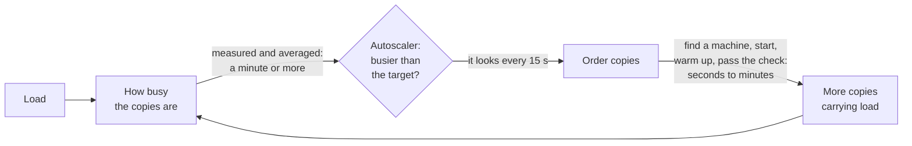

# 9.7 Capacity planning and autoscaling

[Syllabus](../SYLLABUS.md) · Phase 9 · Previous: [9.6 Service-to-service communication](06-service-to-service-communication.md) · Next: [9.8 Cost](08-cost.md)

> **Time:** about 35 minutes to read, 40 minutes of practice.
> **You need:** load tests and percentiles from [Chapter 1.7](../phase-1-foundations/07-measuring-performance.md), pools and queues from [Chapter 1.6](../phase-1-foundations/06-concurrency-pools-queues.md), and zones from [Chapter 6.5](../phase-6-reliability/05-redundancy-and-failure-domains.md). The example needs only Go, and runs at once.

**By the end of this chapter you can**

- measure what one copy of a service can carry, and turn a forecast into a number of copies;
- say what headroom is for, and how much is needed;
- explain an autoscaler as a control loop, and work out how long it takes to react;
- say what an autoscaler cannot react to, and what to use in its place;
- choose a signal to scale on, and recognise one that misleads;
- find the parts of a system that do not grow with the rest;
- use a load test to plan with, and not only to check with.

---

## The problem

*An illustrative scenario; the example reproduces it.* The invoicing product is used at work. Every weekday at 08:55 its customers sit down, and by 09:00 the load has tripled.

Autoscaling is on, aiming at 70% CPU. The dashboard shows it doing its job: six copies, then nine, then thirteen, then eighteen. The dashboard also shows nearly seven minutes of errors, every weekday morning, and about 105,000 failed requests.

Nobody is surprised any more. The fix that is proposed each quarter is a lower target, which costs more and does not work.

Three things are wrong.

1. **An autoscaler is a control loop with a delay,** and the load moved faster than the loop.
2. **Nobody had written down the numbers:** what one copy can carry, how much load comes, and when.
3. **The peak comes at the same time every day.** Nothing needed to *react* to it.

---

## The concept

### 1. Capacity is a number, and you measure it

The **capacity** of one copy is the load that it carries while still meeting its SLO. It is not the load at which it falls over, which is higher and of no use to anyone.

You find it with a load test (Chapter 1.7): raise the load on one copy in steps, and stop where the slow requests cross the objective. Then:

*copies needed = peak load ÷ capacity of one copy, rounded up, and then headroom* (section 3).

- **It is measured, and not remembered.** "Use load testing rather than tradition to establish the resource-to-capacity ratio" ([Google SRE book, *A Collection of Best Practices for Production Services*](https://sre.google/sre-book/service-best-practices/)).
- **It is measured, and not reasoned.** "Unless you test in a realistic environment, it's very hard to predict exactly which resource will be exhausted and how that resource exhaustion will manifest" ([Google SRE book, *Addressing Cascading Failures*](https://sre.google/sre-book/addressing-cascading-failures/)).
- **It goes out of date.** A release that adds one query to a request changes it. Measure again after changes of that kind, and at least on a schedule.
- **It belongs to the whole path.** A copy that can carry 100 requests a second is of no use behind a database that can carry 60 of them (section 5).

### 2. Demand: what is coming, and when

The other number is the load. It has three parts.

- **Cycles:** the day, the week, the end of the month. These are known, and they repeat.
- **Growth.** The SRE book calls it organic: it "stems from natural product adoption and usage by customers".
- **Events:** inorganic growth, which "results from events like feature launches, marketing campaigns, or other business-driven changes" (both from the [Google SRE book, *Introduction*](https://sre.google/sre-book/introduction/)). Engineering hears of these last unless it asks.

A forecast has to reach further ahead than the time that capacity takes to arrive. The same page asks for "An accurate organic demand forecast, which extends beyond the lead time required for acquiring capacity" ([*Introduction*](https://sre.google/sre-book/introduction/)). In a cloud the lead time for one more copy is minutes. For a larger database it is a planned change. For a raised quota it is a support ticket, and for a new region it is a project.

Plan for the peak, and not for the average. Nobody is served by the average.

### 3. Headroom: why not run full

Headroom is capacity that is not being used at the peak. Each part of it pays for something.

| What it pays for | Why |
|---|---|
| Queues | Waiting grows steeply long before a server is full (Chapter 1.6) |
| The time it takes to react | Load goes on growing while new copies start (section 4) |
| A failure | When a zone is lost, the rest carries its load (Chapter 6.5) |
| A deploy | Replacing copies takes some out of service (Chapter 9.1) |
| A forecast that was wrong | They are |

The failure row has a rule of thumb from AWS's own services: "when we use three Availability Zones, we overprovision by 50 percent. Put another way, we overprovision such that each Availability Zone is operating at only 66 percent of the level for which we have load-tested it" ([AWS Builders' Library, *Static stability using Availability Zones*](https://aws.amazon.com/builders-library/static-stability-using-availability-zones/)). Google's rule is called N + 2: "Provision to handle a simultaneous planned and unplanned outage, without making the user experience unacceptable" ([Google SRE book, *A Collection of Best Practices for Production Services*](https://sre.google/sre-book/service-best-practices/)).

So a target of 70% busy is not 30% waste. It is the price of the five rows.

### 4. An autoscaler is a control loop, and it has a delay

An autoscaler measures how busy the copies are, compares that with a target, and changes the number of copies. AWS's comparison: "this is similar to how a thermostat maintains a target temperature" ([Amazon EC2 Auto Scaling documentation, *Target tracking scaling policies*](https://docs.aws.amazon.com/autoscaling/ec2/userguide/as-scaling-target-tracking.html)).

Kubernetes documents its rule exactly. Its autoscaler "operates on the ratio between desired metric value and current metric value" ([Kubernetes documentation, *Horizontal Pod Autoscaling*](https://kubernetes.io/docs/concepts/workloads/autoscaling/horizontal-pod-autoscale/)):

*copies wanted = ceil(copies now × signal now ÷ target)*



Every arrow takes time. Add them up, because the sum is the autoscaler's **reaction time**.

| Step | How long |
|---|---|
| The signal is measured, and the autoscaler looks at it | Kubernetes looks at intervals: "the default interval is 15 seconds" ([Kubernetes, the same page](https://kubernetes.io/docs/concepts/workloads/autoscaling/horizontal-pod-autoscale/)). On EC2, "all Amazon EC2 metrics are published in five-minute intervals, but they are configurable to a lower interval of one minute" ([EC2 Auto Scaling, the same page](https://docs.aws.amazon.com/autoscaling/ec2/userguide/as-scaling-target-tracking.html)) |
| A machine is found, or started | Nothing if there is a spare one. Minutes if not |
| The program starts, warms up and passes its readiness check | Chapter 9.1. Seconds for a small program, minutes for some |

Two consequences follow, and the example shows both.

**Load that outgrows the headroom within one reaction time is refused.** At a target of 70%, the copies can absorb about 40% more load than they have. If more than that arrives before new copies do, the difference fails.

**A full copy reads 100%, however much it is turning away.** So the rule above can ask for at most 1 ÷ 0.7 of the present copies, which is 1.43 times as many. Copies that are still starting do not change that: Kubernetes "conservatively assumes that the not-yet-ready pods are consuming 0% of the desired metric, further dampening the magnitude of a scale up" (the same [Kubernetes page](https://kubernetes.io/docs/concepts/workloads/autoscaling/horizontal-pod-autoscale/)). To triple, the loop needs three rounds, and each round lasts one reaction time.

**Going down is slow on purpose.** A fleet that shrinks at every dip will be short at the next rise. In Kubernetes, "For scaling down the stabilization window is 300 seconds" (the same [Kubernetes page](https://kubernetes.io/docs/concepts/workloads/autoscaling/horizontal-pod-autoscale/)): it removes copies only when it has wanted fewer for five minutes.

### 5. What an autoscaler cannot do

**It cannot keep up with a step.** Monzo's engineers on a load that jumps in seconds: "For cases where traffic increases gradually over minutes or more, auto-scaling works perfectly, but when traffic increases by over 500% in a matter of seconds it simply can't react quickly enough" ([Joe Rowe, Monzo, 2023](https://monzo.com/blog/2023/01/26/preparing-for-spikes-in-traffic-as-millions-get-paid-early)).

**It cannot see a limit that its signal does not show.** If copies are full while their CPU is low, an autoscaler that watches CPU sees spare capacity. AWS's requirement for a signal: "The metric must be a valid utilization metric and describe how busy an instance is" ([Amazon EC2 Auto Scaling documentation, *Target tracking scaling policies*](https://docs.aws.amazon.com/autoscaling/ec2/userguide/as-scaling-target-tracking.html)).

**It cannot grow what does not grow.** More copies of the application are more connections to the same database (Chapters 1.6 and 2.6), more calls to the same downstream service, and more requests against the same quota. The autoscaler multiplies the callers, and the thing that they call is the size that it was.

**It cannot be relied on in a failure.** After a zone is lost, the plan *scale up in the others* depends on capacity that every other customer of the region is asking for at the same moment. AWS's judgement of that plan: "This approach is less effective because it relies on reacting to impairments as they happen, rather than being prepared for those impairments before they happen" ([AWS Builders' Library, *Static stability using Availability Zones*](https://aws.amazon.com/builders-library/static-stability-using-availability-zones/)). The capacity for a failure has to be running already. That is the 66 percent of section 3.

**It cannot cure an overload that feeds itself.** In a retry storm (Chapter 6.1), more copies of the callers send more retries.

### 6. Choosing the signal

A good signal has two properties. It measures the thing that runs out first. And it falls when copies are added: "The metric value must increase or decrease proportionally to the number of instances in the Auto Scaling group" ([Amazon EC2 Auto Scaling documentation, *Target tracking scaling policies*](https://docs.aws.amazon.com/autoscaling/ec2/userguide/as-scaling-target-tracking.html)).

| The service | Scale on | Not on |
|---|---|---|
| Limited by its processors | CPU | |
| Limited by waiting: for a database, for other services | Requests in flight, or requests a second, for each copy | CPU, which stays low |
| Workers that read a queue | The backlog for each worker (Chapter 4.2) | CPU; or the backlog alone |
| Any | | Latency |

The last two rows are from the same AWS page. On a queue: "a custom metric that measures the number of messages in the queue per EC2 instance in the Auto Scaling group can work." On latency: "Request latency can increase based on increasing utilization, but doesn't necessarily change proportionally" ([*Target tracking scaling policies*](https://docs.aws.amazon.com/autoscaling/ec2/userguide/as-scaling-target-tracking.html)). Latency also rises when a dependency is slow, and then more copies help nobody.

Which resource runs out first is not a matter of opinion. The load test of section 1 shows it.

### 7. When you know, do not react

A peak that comes at 09:00 every weekday does not need a control loop. It needs a clock. "With scheduled scaling, you can set up automatic scaling for your application based on predictable load changes" ([Amazon EC2 Auto Scaling documentation, *Scheduled scaling*](https://docs.aws.amazon.com/autoscaling/ec2/userguide/ec2-auto-scaling-scheduled-scaling.html)).

- **A daily or weekly cycle:** a schedule that sets a floor before the rise.
- **An event that you know of:** scale before it, by a number worked out from the last one like it.
- **Everything else:** the autoscaler, above the floor.

Autoscalers can also learn a cycle for themselves; one line and a link: "Predictive scaling works by analyzing historical load data to detect daily or weekly patterns in traffic flows" ([Amazon EC2 Auto Scaling documentation, *Predictive scaling*](https://docs.aws.amazon.com/autoscaling/ec2/userguide/ec2-auto-scaling-predictive-scaling.html)).

### 8. A load test is a planning tool

Chapter 1.7 used a load test to find out how fast a service is. For planning it answers three more questions.

1. **What does one copy carry?** That is the number of section 1.
2. **What breaks first as the whole system grows?** "Load test components until they break" ([Google SRE book, *Addressing Cascading Failures*](https://sre.google/sre-book/addressing-cascading-failures/)). The first thing to break is the next thing to fix, and it is seldom the thing that scales.
3. **Does the scaling itself work, at the speed of real load?** Raise the load as fast as a real morning does. The autoscaler, the quotas, the start-up time and the connection limits are all under test.

The same book joins the test to the plan: "Capacity planning should be coupled with performance testing to determine the load at which the service will fail" (the same chapter of the [Google SRE book](https://sre.google/sre-book/addressing-cascading-failures/)).

---

## A real example

### Run it: a day of load, and five ways to meet it

[`code/ch07-capacity/main.go`](code/ch07-capacity/main.go) is about 200 lines. **It is a model, and not a measurement.** It steps through a day one second at a time. Its autoscaler follows the rule that Kubernetes documents: it looks every 15 seconds, wants *ceil(copies × signal ÷ target)*, does nothing while the signal is within a tenth of the target, and removes copies only after five minutes of wanting fewer. A request beyond what the ready copies can carry is counted as failed, and nothing worse happens to the others. A real overload is less kind (Chapter 6.4).

```bash
go run ./phase-9-shipping/code/ch07-capacity
```

```text
PART 1 — one copy carries 100 requests a second. Between 08:55 and 09:00 the load triples, to 1,200.

  how the copies are provided                        copies at    most  requests  minutes copy-hours
                                                         08:55  copies    failed    short in the day
  a fixed fleet, sized for the peak at 70% busy             18      18         0      0.0        432
  an autoscaler: 70% busy, 3 minutes to start a copy         6      18   104,700      6.7        206
  …aiming at 50% busy                                        8      25    10,125      1.9        284
  …aiming at 70%, with 30 seconds to start a copy            6      17       280      0.2        203
  …at 70%, 3 minutes, and 18 copies from 08:45              18      18         0      0.0        224

  the second row, minute by minute:
       at     load   copies ready   starting   failed in the minute
    08:55      400              6          0                      0
    08:56      560              6          0                  2,640
    08:57      720              6          3                 11,920
    08:58      880              6          3                 21,520
    08:59     1040              7          2                 19,120
    09:00     1200              9          2                 18,000
    09:01     1200              9          4                 18,000
    09:02     1200              9          4                 13,500
    09:03     1200             12          2                      0
    09:04     1200             13          4                      0
    09:05     1200             13          5                      0
    09:06     1200             14          4                      0
    09:07     1200             18          0                      0
    09:08     1200             18          0                      0
    09:09     1200             18          0                      0
    09:10     1200             18          0                      0
```

- **Row 1** never fails, and pays for eighteen copies all night: 432 copy-hours.
- **Row 2 is the scenario.** It costs less than half as much, and fails 104,700 requests each morning.
- **Row 3 is the fix that is proposed each quarter.** A target of 50% costs 38% more than row 2, and still fails 10,125 requests. More headroom buys time, and the load uses it up.
- **Row 4 shortens the delay.** With copies that are ready in 30 seconds, the same target of 70% fails 280 requests in the day.
- **Row 5 uses a clock.** Eighteen copies are ordered for 08:45, and the autoscaler does the rest of the day. Nothing fails, for 9% more than row 2.

The second table shows why row 2 fails for so long. The load passes what six copies can carry soon after 08:56. The autoscaler orders copies within the minute, and it can order only three: six full copies, divided by 0.7, is nine. They arrive three minutes later, and they are full on arrival. So it orders up to thirteen, and then up to eighteen. Tripling takes three rounds of three minutes.

The rule is these lines:

```go
		all := ready + len(starting)
		want := all
		if ratio := signal / d.target; math.Abs(ratio-1) > 0.1 {
			want = int(math.Ceil(float64(ready) * ratio)) // copies that are starting count as idle
		}
```

```text
PART 2 — the same day and an autoscaler that is fast enough: 70% busy, 30 seconds to start a copy.

  what the autoscaler cannot see                                most     requests   of the day's
                                                              copies       failed       requests
  nothing: its signal is how busy a copy really is                17          280           0.0%
  its signal is CPU, and a copy is full at 40% CPU                 3   32,550,000          65.3%
  the database has 200 connections, and each copy takes 20        13    4,312,780           8.7%
  …and each copy's pool is cut to 8 connections                   17          280           0.0%
```

Part 2 gives the autoscaler the fast start of row 4, so that the delay is not the trouble.

- **Row 2: the signal misleads.** These copies spend their time waiting for database connections, and are full when their CPU reads 40%. The autoscaler aims at 70% CPU, sees less, and concludes that there are too many copies. It lets them go, down to its minimum, and 65% of the day's requests fail. Nothing in its own view is wrong.
- **Row 3: the limit is somewhere else.** The signal is honest, and the autoscaler adds copies. But the database accepts 200 connections, and each copy holds 20. The eleventh copy and those after it start, and can reach nothing. Capacity stops at 1,000 requests a second, and 4.3 million requests fail in the day.
- **Row 4** changes one number that is not in the autoscaler at all: the size of each copy's pool. With 8 connections each, 25 copies fit. Whether 8 are enough for a copy is the arithmetic of Chapter 1.6, and of the exercise below.

### How Monzo scales before a spike that it knows is coming

Monzo lets customers ask for their salary a day early, from 4pm. The article describes what happened: "a huge wave of these requests would hit us at exactly 4pm", and "These bursts of traffic mean that the workload of our microservices increases by orders of magnitude within the space of about 30 seconds" ([Joe Rowe, *Preparing for traffic as our customers get paid early*, Monzo, 2023](https://monzo.com/blog/2023/01/26/preparing-for-spikes-in-traffic-as-millions-get-paid-early)).

| | In the article's words ([the same article](https://monzo.com/blog/2023/01/26/preparing-for-spikes-in-traffic-as-millions-get-paid-early)) |
|---|---|
| Why the autoscaler is not enough | "it takes some time to kick in and some more time for extra instances to start up and begin serving traffic" |
| What it is still used for | "we use auto-scaling to handle day-to-day increases in user traffic" |
| How the number is chosen | "we can look at the maximum CPU utilisation nine days ago and use it to determine how much to scale up by today" |
| The result on the day | "Notice how when our GPE event happened we had plenty of headroom?" |

That is section 7, in production: the size of each event is known in advance, a past event of the same size supplies the number, and the platform is scaled before 4pm and not after.

### How a signal misled Slack

On 4 January 2021, network trouble made Slack's web servers wait longer for their backends. The servers' threads were busy waiting, and their processors were not. "The network problems prior to 7:00am PST meant that the threads were spending more time waiting, which caused CPU utilization to drop. This drop in CPU utilization initially triggered some automated downscaling" ([Laura Nolan, *Slack's Outage on January 4th 2021*, Slack Engineering](https://slack.engineering/slacks-outage-on-january-4th-2021/)). That is row 2 of part 2.

A second signal, the use of worker threads, then asked for capacity all at once: "We attempted to add 1,200 servers to our web tier between 7:01am PST and 7:15am PST" (the same [article](https://slack.engineering/slacks-outage-on-january-4th-2021/)). The service that prepares new servers could not keep up. It "hit two separate resource bottlenecks (the most significant one was the Linux open files limit, but we also exceeded an AWS quota limit)", and so "We had created a large number of instances, but most of them were not fully provisioned and were not serving" (the same [article](https://slack.engineering/slacks-outage-on-january-4th-2021/)). That is row 3: the thing that did not scale was the machinery of scaling.

### How Shopify tests the plan

Shopify's peak is a few days a year, so the plan cannot be learnt from last week. It is tested instead. "From April through October we ran five major scale tests at forecasted traffic levels", and the reason for testing everything together is that this "validates the entire platform working together at BFCM volumes, revealing issues that only surface when everything runs at capacity simultaneously" ([Kyle Petroski and Matthew Frail, *How we prepare Shopify for BFCM (2025)*, Shopify Engineering](https://shopify.engineering/bfcm-readiness-2025)). That is the third question of section 8.

---

## Trade-offs

**Headroom against cost.** The first table prices it. A fleet that is always big enough costs 432 copy-hours a day. An autoscaler with a schedule costs 224, and fails nothing either. The difference is the money that autoscaling is for (Chapter 9.8).

**A lower target against a faster start.** Both give the loop more time. The lower target is paid for all day: 284 copy-hours against 206. A faster start is paid for once, in engineering: a smaller image, spare machines, less work before the first request (Chapter 9.1). In the model the faster start did far more.

**Reacting against knowing.** A schedule is exact about what repeats, and blind to what does not. An autoscaler is the opposite. Use both: the schedule sets a floor, and the autoscaler works above it.

**A simple signal against a true one.** CPU needs no work, and is right for services that compute. A service that waits needs a signal that someone has to build and trust.

**Capacity that is running against capacity that can be ordered.** Running capacity costs money every hour and is there in a failure. Capacity on order costs nothing until it is wanted, and may not come.

**Going down quickly against going down slowly.** Quickly saves money in each dip, and is short at each rise.

---

## Practice

### Check yourself

1. An autoscaler aims at 75% busy. It takes four minutes from a rise in load to new copies carrying it. Roughly how fast can the load grow before requests fail? Give three ways of surviving faster growth.
2. A fleet of workers reads from a queue and is scaled on CPU. The queue has grown for an hour, and CPU is at 30%. Why has the fleet not grown, and what should it be scaled on? What should you check before changing the signal?
3. A zone fails. The service runs full on the two that remain, and its orders for new copies are not being filled. What was wrong with the plan?

<details>
<summary>Answers</summary>

1. At 75% busy, the copies can carry a third more than they are carrying. If the load grows by more than a third in four minutes, about 8% a minute, the rest is refused. To survive more: a lower target, which is more headroom; a shorter reaction time, from a faster signal and copies that start faster; or a schedule, where the growth is known. And in every case, shed what cannot be carried, so that the rest is served (Chapter 6.4).
2. The workers are waiting for something, and waiting does not use the processor. The signal says that they are idle. Scale on the backlog for each worker, or on the age of the oldest message. But first find what they wait for. If it is a downstream service that is itself full, more workers will only load it further, and the right fix is there.
3. It depended on reacting. New capacity was to be ordered at the moment when everyone else in the region wanted it too. The capacity to carry the peak on two zones had to be running before the failure: three zones, each at no more than about two thirds of what it was tested for.

</details>

### Exercise: lose a zone, and write a plan

1. **Predict, then run.** Add an event to the model: at 10:30 a third of the copies are lost. Run it with the schedule of row 5, for targets of 70% and of 85%, each with a floor sized for its target. What fails?
2. **Write the plan.** A load test shows that one copy carries 100 requests a second within its SLO, and that each request holds a database connection for 20 ms. Today's peak is 1,200 requests a second, and it has grown 5% a month for a year. The service runs in three zones and must survive the loss of one at the peak. The database accepts 200 connections. Plan for six months from now: how many copies, how busy at the peak, and what size of connection pool?

<details>
<summary>Worked solution</summary>

**1.** The event is three lines in the loop:

```go
		if d.zoneLost != "" && t == clock(d.zoneLost) {
			ready -= ready / 3 // a third of the copies were in the zone that failed
		}
```

```text
  a zone is lost at 10:30, and the autoscaler aims at copies at    most  requests  minutes copy-hours
                                                         08:55  copies    failed    short in the day
  70% busy, with 18 copies from 08:45                       18      18         0      0.0        224
  85% busy, with 15 copies from 08:45                       15      15    36,000      3.0        191
```

At 70%, eighteen copies become twelve, and twelve carry 1,200 requests a second exactly. Nothing fails. This is the 66 percent of section 3, arrived at from the other side.

At 85%, fifteen copies become ten. Ten carry 1,000, and 200 requests a second fail for the three minutes that replacements take: 36,000 requests. The higher target saved 33 copy-hours a day, about 15%. Whether that is a good trade is a question about how often a zone fails and what 36,000 failed requests cost. It is not a question for a default.

**2.** *The load.* 1,200 × 1.05⁶ is about 1,610 requests a second.

*The copies.* Seventeen copies carry 1,610. With one zone of three gone, the other two must hold seventeen: nine in each zone, so 27 in all.

*How busy.* At the peak with every zone, 1,610 ÷ 2,700 is 60%. With a zone lost, 1,610 ÷ 1,800 is 89%: carried, with little to spare. If the forecast may be 10% low, plan for ten in each zone.

*The pool.* One copy uses 100 × 0.02 = 2 connections on average (Chapter 1.6). A pool of 6 is three times that. 27 copies × 6 is 162 connections, which fits in 200. A pool of 20 would need 540, and the database would turn most copies away.

*The deploy.* A deploy that starts new copies before it stops old ones runs more than 27 for a while. With seven extra, pools of 6 need 204 connections. So use pools of 5, or put a pooler in front of the database (Chapter 2.6).

*How the copies are provided.* A schedule orders the 27 before the morning rise. An autoscaler works above that floor, and its signal is requests in flight, because these copies wait for a database.

*What the plan does not yet know.* Whether the database itself carries 1,610 requests a second. Changing it has the longest lead time in the plan, so that is the load test to run first. And the number 100 is re-measured after any release that changes what a request does.

</details>

---

## Production tips and common mistakes

- **Write down three numbers:** what one copy carries, what the peak is, and when it comes.
- **Measure the first with a load test,** and measure it again when the service changes.
- **Know your reaction time.** Add up the signal, the look, the machine and the start-up.
- **Shorten the start-up.** It helps the autoscaler, the deploy and the recovery from a failure at once (Chapter 9.1).
- **Scale on what runs out first.** If the copies wait, do not scale on CPU.
- **Put known peaks on a schedule,** and let the autoscaler handle the rest above that floor.
- **Set a floor and a ceiling.** The floor is what you need if the autoscaler is wrong. The ceiling is what the database, the downstream services and the budget can bear.
- **Size connection pools for the largest number of copies,** including the extra copies of a deploy (Chapters 1.6 and 2.6).
- **Keep the capacity for a failure running.** Do not plan to order it during the failure.
- **Let the fleet shrink slowly.**
- **Test the scaling, and not only the service:** raise the load as fast as a real morning does.
- **Ask about launches and campaigns.** Nobody will tell you.
- **Check quotas and limits before the peak,** and not during it.

Common mistakes:

- **Autoscaling switched on, and nothing measured.**
- **A target lowered again and again,** where the delay was the trouble.
- **CPU as the signal for a service that waits.**
- **Latency as the signal.**
- **An autoscaler with no ceiling, in front of a database with one.**
- **A daily peak met by reaction.**
- **Capacity for a zone failure that exists only as a plan to scale.**
- **A plan for the average.**
- **A load test of one service, and a peak that breaks another.**

---

## Key takeaways

- Capacity is measured: the load that one copy carries within its SLO. Demand is forecast: cycles, growth and events. The plan is the second divided by the first, with headroom.
- Headroom pays for queues, for the time it takes to react, for a failure, for a deploy and for a wrong forecast. Three zones at two thirds each survive the loss of one.
- An autoscaler is a control loop with a delay. It can follow load that grows slowly against its reaction time. A full copy reads 100% and no more, so large growth takes several rounds.
- It cannot follow a step, see a limit that its signal does not show, grow a database, or be counted on during a failure.
- Scale on the thing that runs out first. Put what you know on a schedule. Make copies start faster before lowering the target.
- Use load tests to find the number, the next bottleneck, and whether scaling works at the speed of real load.

**Next:** [9.8 Cost](08-cost.md) — every copy-hour in this chapter's tables is on a bill. Reading that bill, and deciding what each part of a design is worth, is next.

---

## Sources

- Kubernetes documentation, [*Horizontal Pod Autoscaling*](https://kubernetes.io/docs/concepts/workloads/autoscaling/horizontal-pod-autoscale/).
- Amazon EC2 Auto Scaling documentation: [*Target tracking scaling policies*](https://docs.aws.amazon.com/autoscaling/ec2/userguide/as-scaling-target-tracking.html); [*Scheduled scaling*](https://docs.aws.amazon.com/autoscaling/ec2/userguide/ec2-auto-scaling-scheduled-scaling.html); [*Predictive scaling*](https://docs.aws.amazon.com/autoscaling/ec2/userguide/ec2-auto-scaling-predictive-scaling.html).
- Google, *Site Reliability Engineering*, 2016: [*Introduction*](https://sre.google/sre-book/introduction/); [*Addressing Cascading Failures*](https://sre.google/sre-book/addressing-cascading-failures/); [*A Collection of Best Practices for Production Services*](https://sre.google/sre-book/service-best-practices/).
- AWS Builders' Library, [*Static stability using Availability Zones*](https://aws.amazon.com/builders-library/static-stability-using-availability-zones/).
- Joe Rowe, [*Preparing for traffic as our customers get paid early*](https://monzo.com/blog/2023/01/26/preparing-for-spikes-in-traffic-as-millions-get-paid-early), Monzo, 2023.
- Laura Nolan, [*Slack's Outage on January 4th 2021*](https://slack.engineering/slacks-outage-on-january-4th-2021/), Slack Engineering, 2021.
- Kyle Petroski and Matthew Frail, [*How we prepare Shopify for BFCM (2025)*](https://shopify.engineering/bfcm-readiness-2025), Shopify Engineering, 2025.
