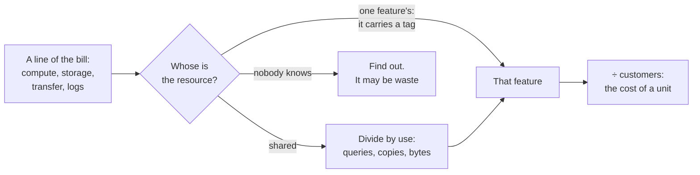

# 9.8 Cost

[Syllabus](../SYLLABUS.md) · Phase 9 · Previous: [9.7 Capacity planning and autoscaling](07-capacity-planning-and-autoscaling.md) · Next: 9.9 The design process *(planned)*

> **Time:** about 30 minutes to read, 35 minutes of practice.
> **You need:** availability as a number, from [Chapter 1.1](../phase-1-foundations/01-what-production-demands.md); zones and regions, from [Chapter 6.5](../phase-6-reliability/05-redundancy-and-failure-domains.md); and copies, headroom and schedules, from [Chapter 9.7](07-capacity-planning-and-autoscaling.md). The example needs only Go, and runs at once.

**By the end of this chapter you can**

- read a cloud bill, and name the lines that surprise people;
- give every pound an owner: with tags, and by dividing shared things by use;
- work out what one customer costs, and say whether a bill grew faster than the business;
- put a price on one more nine, and compare it with what the nine is worth;
- name the ways of reducing a bill, in the order in which to try them;
- treat cost as a requirement of a design, with a number.

---

## The problem

*An illustrative scenario; the example reproduces it.* In a year the invoicing product's bill has gone from £19,000 a month to £61,000. The finance director asks a fair question: which feature did it?

Nobody can say. The bill has six lines: compute, database, storage, data transfer, logs, support. None of them is a feature. Two engineers spend two weeks with spreadsheets, and find four things.

- A feature that was launched in October, and that 120 customers use.
- Debug logging that was switched on during an incident in February, and never off.
- A load-test environment that has been running since March.
- Traffic between zones, which nobody chose and nobody knew was charged.

Three things are wrong.

1. **Nothing has an owner.** The lines of a bill are the provider's products, and not yours.
2. **Nobody knows what a customer costs.** So nobody can tell whether a bill that tripled is growth or waste.
3. **Cost was never a number in a design.** It was found out afterwards, from the invoice.

---

## The concept

### 1. What is on a bill

| The line | What you pay for | What surprises |
|---|---|---|
| Compute | An hour of a machine of some size, used or not | Copies with nothing to do, and environments that nobody uses |
| Storage | A gigabyte kept for a month, and requests | It only grows. Nothing is deleted unless somebody decides so: backups, old versions, exports |
| Data transfer | A gigabyte moved, by direction | Out to the internet costs. So does moving between zones and regions |
| Managed services | Hours, storage and requests of a database, a queue, a search cluster | A size chosen for a peak that has passed |
| Logs, metrics, traces | A gigabyte taken in; a series kept (Chapter 7.1) | It grows with every log line and every label |
| Support and licences | A plan, or a contract | |

Data transfer is the line that designs forget. AWS's architects say so: "Data transfer charges are often overlooked while architecting a solution in AWS" ([AWS Architecture Blog, *Overview of Data Transfer Costs for Common Architectures*](https://aws.amazon.com/blogs/architecture/overview-of-data-transfer-costs-for-common-architectures/)). The same article gives the rules.

- **In is free.** "There is no charge for inbound data transfer across all services in all Regions" ([the same article](https://aws.amazon.com/blogs/architecture/overview-of-data-transfer-costs-for-common-architectures/)).
- **Between zones is not.** With servers in separate zones, "data transfer charges apply for cross-Availability Zone communication between the EC2 instances" ([the same article](https://aws.amazon.com/blogs/architecture/overview-of-data-transfer-costs-for-common-architectures/)).
- **A gateway on the way counts too.** Through a NAT gateway, "there is a data processing charge (per gigabyte (GB)) for data that passes through the gateway" ([the same article](https://aws.amazon.com/blogs/architecture/overview-of-data-transfer-costs-for-common-architectures/)).

So the redundancy of Chapter 6.5 and the service boundaries of Chapter 9.5 both appear on this line.

### 2. Three ways to pay for compute

| | You get | You give |
|---|---|---|
| **On demand** | Any amount, for as long as you like | The full price |
| **Committed** | A lower price | A promise to pay for a fixed amount for one or three years |
| **Spare capacity** (spot) | A much lower price | The provider may take the machine back at short notice |

A commitment is "savings beyond On-Demand rates in exchange for a commitment of using a specified amount of compute power (measured per hour) for a one or three year period", and AWS advertises that "You can save up to 72%" ([AWS documentation, *What are Savings Plans?*](https://docs.aws.amazon.com/savingsplans/latest/userguide/what-is-savings-plans.html)).

Spare capacity is for work that can stop: "a cost-effective choice if you can be flexible about when your applications run and if your applications can be interrupted", and the warning is short: the provider "gives the instance a two-minute warning before it is interrupted" ([Amazon EC2 documentation, *Spot Instances*](https://docs.aws.amazon.com/AWSEC2/latest/UserGuide/using-spot-instances.html)).

The three fit the fleet of Chapter 9.7. **Commit to the floor**, which runs day and night. **Pay on demand for what the autoscaler adds.** **Use spare capacity for work that can be interrupted**: batch jobs, and workers whose jobs are safe to run again (Chapter 4.2).

### 3. Give every pound an owner

**Tags are the first step.** "A tag is a label that you or AWS assigns to an AWS resource", and with them you can "track your AWS costs on a detailed level" ([AWS Billing documentation, *Organizing and tracking costs using AWS cost allocation tags*](https://docs.aws.amazon.com/awsaccountbilling/latest/aboutv2/cost-alloc-tags.html)). Put the tag on a resource where the resource is declared, in the infrastructure's code (Chapter 9.4), and refuse a change that creates anything without one.

**Tags are not enough.** The largest things are shared: the database, the cluster, the network, the logs. A tag on the database says *platform*, and that answers nothing. A shared thing has to be **divided by use**: the database by the time that each feature's queries take, the cluster by copies, the logs by bytes. This is arithmetic on data that the telemetry of Phase 7 already holds.

**Show the result to the people who can change it.** AWS's principle: "The cloud makes it easier to accurately identify the cost and usage of workloads, which then allows transparent attribution of IT costs to revenue streams and individual workload owners" ([AWS Well-Architected Framework, *Cost Optimization Pillar: Design principles*](https://docs.aws.amazon.com/wellarchitected/latest/cost-optimization-pillar/design-principles.html)).



The practice has a name, FinOps; one line, and a link: it "creates financial accountability through collaboration between engineering, finance, and business teams" ([FinOps Foundation, *What is FinOps?*](https://www.finops.org/introduction/what-is-finops/)).

### 4. Unit cost: is it growth, or is it waste?

A bill by itself cannot be judged. Spotify's engineers put it this way: "Without broader context, it's difficult to determine whether $10,000, for example, might be an appropriate amount to spend" ([Spotify Engineering, *Managing Clouds from the Ground Up: Cost Engineering at Spotify*](https://engineering.atspotify.com/2020/09/managing-clouds-from-the-ground-up-cost-engineering-at-spotify)).

The context is a **unit**: the bill divided by something that the business counts. A customer, an invoice sent, a thousand requests. The FinOps Foundation's definition: "Unit Economics brings together what an organization spends on technology and the value that technology spending creates" ([FinOps Foundation, *Unit Economics*](https://www.finops.org/framework/capabilities/unit-economics/)).

Then a change in the bill can be read.

| The bill grew, and the cost of a unit | It means |
|---|---|
| Fell | Growth. Fixed costs are spread over more customers |
| Stayed the same | Probably growth. Look for waste that grew at the same rate |
| Rose | Something other than the business is growing. Find it |

Two refinements matter in practice.

- **By feature.** One feature may account for the rise (the example).
- **By kind of customer.** A few customers may cost more than they pay. That is a question of price, and it belongs to the business. But only engineering can supply the number.

### 5. The price of a nine

Each nine of availability (Chapter 1.1) costs more than the one before. Google's SRE book: "an incremental improvement in reliability may cost 100x more than the previous increment" ([Google SRE book, *Embracing Risk*](https://sre.google/sre-book/embracing-risk/)). The cost has two parts, by the same chapter: "The cost of redundant machine/compute resources", and the opportunity cost of engineers who build reliability and not features.

The book also gives the question to ask, and a sum. The question: "If we were to build and operate these systems at one more nine of availability, what would our incremental increase in revenue be?" The sum, for a service that earns $1M and moves from 99.9% to 99.99%: the improvement is 0.09%, so it is worth $900, and "if the cost of improving availability by one nine is less than $900, it is worth the investment" (both from [*Embracing Risk*](https://sre.google/sre-book/embracing-risk/)).

The sum is a starting point. It assumes that revenue is lost in proportion to the minutes of failure. It leaves out customers who leave after a bad day, refunds that a contract promises, and the support calls. Put those in where you can estimate them.

Two rules follow.

- **Choose the nines for each service, and not for the company.** Signing in needs more than a monthly report does (Chapter 7.2).
- **Know what the step costs before promising it.** In the example below, going from one zone to three about doubles the cost of the service. A second region doubles it again, and adds the hardest problems of Chapter 6.6.

### 6. Designing with cost in mind

There is an order in which to look for savings, and it runs from what costs least effort to what costs most.

1. **Stop doing it.** Turn off what nobody uses. Delete what nobody reads. Do not log what nobody will read. Storage can be told to do this by itself: "S3 Lifecycle helps you store objects cost effectively throughout their lifecycle by transitioning them to lower-cost storage classes, or, deleting expired objects on your behalf" ([Amazon S3 documentation, *Managing the lifecycle of objects*](https://docs.aws.amazon.com/AmazonS3/latest/userguide/object-lifecycle-mgmt.html)).
2. **Do less of it.** Cache (Chapter 3.3), compress, sample traces (Chapter 7.4), serve bytes from a CDN (Chapter 3.5). Keep a call in its zone where there is a copy there: Kubernetes can "prefer keeping traffic in the zone it originated from", which "can help reduce costs or improve network performance" ([Kubernetes documentation, *Topology Aware Routing*](https://kubernetes.io/docs/concepts/services-networking/topology-aware-routing/)).
3. **Make it the right size.** Use the measured capacity of Chapter 9.7, and not a guess with a margin on a margin.
4. **Follow the load.** Autoscaling and schedules (Chapter 9.7). For environments that people use in working hours, AWS's arithmetic: "You can stop these resources when they're not in use for a potential cost savings of 75% (40 hours versus 168 hours)" ([AWS Well-Architected Framework, *Cost Optimization Pillar: Design principles*](https://docs.aws.amazon.com/wellarchitected/latest/cost-optimization-pillar/design-principles.html)).
5. **Pay less for the same.** Commitments for the floor, and spare capacity for interruptible work (section 2).
6. **Change the architecture.** Last, because it costs the most engineering. Count the people in any comparison: a cheaper design that needs a team to run it is not cheaper.

And two habits.

- **A number in every design.** The monthly cost at launch and at ten times the load, the three largest lines, and the cost of a unit (Chapter 9.9).
- **An alert on spending.** A bill that jumps is an incident with a slow fuse. Budgets exist for this: "You can choose to be alerted for both actual (after accruing) and forecasted (before accruing) spends" ([AWS Cost Management documentation, *Managing your costs with AWS Budgets*](https://docs.aws.amazon.com/cost-management/latest/userguide/budgets-managing-costs.html)).

---

## A real example

### Run it: one bill, read four ways

[`code/ch08-cost`](code/ch08-cost/) is two files and about 320 lines. **The usage and the prices are invented**: round numbers, in pounds. The arithmetic is the point, and you can put your own provider's prices into the constants at the top of [`main.go`](code/ch08-cost/main.go). Part 3 is different. It is measured: [`logging.go`](code/ch08-cost/logging.go) runs a real logger and counts the bytes.

```bash
go run ./phase-9-shipping/code/ch08-cost
```

```text
PART 1 — the bill for June, in pounds, as the provider prints it. (Usage and prices are invented.)

                                      last June  this June   grew by
  compute                                 5,840     14,965      2.6×
  database                                5,475      8,760      1.6×
  storage                                 2,600     11,800      4.5×
  data transfer                           1,140      9,000      7.9×
  logs, metrics, traces                   2,290     13,721      6.0×
  support plan                            2,000      3,000      1.5×
  total                                  19,344     61,246      3.2×

  this June again, by the "feature" tag on each resource:
  invoicing                                          3,390        6%
  payments                                           1,168        2%
  reminders                                            730        1%
  search                                             1,022        2%
  (no tag)                                          54,936       90%
```

**The first table is the scenario.** It says that data transfer grew eightfold and logs sixfold. It does not say why, or for whom.

**The second table is the usual first attempt,** and it fails. Only five resources carry a tag. Nine tenths of the bill belongs to nobody, because the large things are shared or were never tagged.

```text
PART 2 — the same money, once each line has an owner and shared things are divided by use.

  what the money goes on              last June  this June     change  of the growth
  invoicing                               7,370     10,829     +3,459             8%
  payments                                2,938      4,002     +1,065             3%
  reminders                               1,451      1,843       +392             1%
  search                                  2,239      2,965       +726             2%
  exports                                     0     18,665    +18,665            45%
  environments that sit idle              2,847      7,300     +4,453            11%
  debug logging                               0      9,642     +9,642            23%
  traffic between zones                     500      3,000     +2,500             6%
  support plan                            2,000      3,000     +1,000             2%
  total                                  19,344     61,246    +41,902
  customers                               2,000      4,000
  for each customer                        9.67      15.31

  this June, a customer who            how many      costs       pays         leaves
  does not use exports                    3,880      10.65      25.00         +14.35
  uses exports                              120     166.18      99.00         -67.18
```

Now the finance director's question has an answer.

- **Exports,** launched in October, is 45% of the growth: its workers, its files that are never deleted, the downloads, and its share of the database.
- **Three things that are not features** are another 40%: idle environments, debug logging, and traffic between zones.
- **The four features that the business was built on** grew by £5,642 between them, for twice the customers. They are cheaper for each customer than they were.

The bottom rows are unit cost. A customer cost £9.67 a month last June and costs £15.31 now, so this is not only growth. The last table says where it went. A customer who does not use exports costs £10.65 and pays £25. A customer who does costs £166.18 and pays £99. That is 120 customers, each served at a loss. What to do about it is a decision about price. Nobody could take it until this number existed.

```text
PART 3 — what a line of logging costs. Measured: a real logger, and a count of the bytes it wrote.

  one call, through one service           bytes   a month of calls        costs
  at INFO: one line                         193           1,158 GB          579
  at DEBUG: ten lines more                3,214          19,284 GB        9,642
```

This row was not invented. The program logs one call as the invoicing code would, at two levels, and counts. One line at INFO is 193 bytes. The ten lines at DEBUG, with two SQL statements and the body of the answer, are 3,214 more. Multiplied by six thousand million calls a month, that is the largest single item of waste on the bill. Nobody decided to spend it. It took one flag, set in an incident, and it takes one measurement to see.

The measurement is a few lines:

```go
	per := func(level slog.Level) float64 {
		var c counter
		log := slog.New(slog.NewJSONHandler(io.Writer(&c), &slog.HandlerOptions{Level: level, ReplaceAttr: fixedTime}))
		for i := 0; i < 1000; i++ {
			handle(log, fmt.Sprintf("inv-%07d", i))
		}
		return float64(c.n) / 1000
	}
```

```text
PART 4 — what more redundancy for invoicing costs, and what the SRE book's sum says a nine is worth.

  the design                                              costs    more than the
                                                        a month        row above
  one zone: 15 copies, one database                       5,475
  three zones: 18 copies, and a standby database         11,074           +5,599
  two regions, each like the row above                   23,348          +12,274

  an availability of                               allows, in a   the step to it
                                                    month, down         is worth
  99.9%                                                43.8 min
  99.99%                                                4.4 min       98 a month
  99.999%                                               0.4 min       10 a month
  (revenue is 108,880 a month; the sum is revenue × the difference in availability)
```

Each step in redundancy about doubles the cost: £5,599 a month more for three zones, and £12,274 more for a second region. By the SRE book's sum, with this product's revenue, the first nine is worth £98 a month and the second £10.

By that sum alone, neither step pays. This is why section 5 called it a starting point. A zone that fails is not down for 43.8 minutes. It may be down for hours, and a product in one zone is down with it. So the first row cannot honestly promise 99.9% in a year when its zone fails. The honest comparison is the first step's cost against one long outage, with the customers that it would lose. The exercise works through it.

```text
PART 5 — five changes to this June's bill, in the order of what each saves.

  the change                                                            saves  the bill  for each
                                                                                is then  customer
  (as it is)                                                                     61,246     15.31
  turn debug logging off                                                9,642    51,604     12.90
  delete the load-test environment; run staging 60 hours a week         5,866    45,738     11.43
  delete export files after 30 days, and not never                      5,775    39,963      9.99
  commit for a year to what always runs: 30% off 70% of it              3,449    36,514      9.13
  send a call to a copy in the caller's own zone when there is one      2,400    34,114      8.53
```

Five changes take the bill from £61,246 to £34,114, and the cost of a customer from £15.31 to £8.53, which is less than it was a year ago. Look at the order. The first three need no new engineering and no negotiation. They stop things, and they are 78% of the saving. The commitment, which needs a forecast and a signature, is fourth. And nothing here touched the price of exports, which is the largest line of all.

### What a real bill looks like: 37signals

37signals published what it spent on cloud services in 2022 ([37signals Dev, *Our cloud spend in 2022*](https://dev.37signals.com/our-cloud-spend-in-2022/)): "In total, we spent $3,201,564 on all these cloud services in 2022."

| The line, from [the same article](https://dev.37signals.com/our-cloud-spend-in-2022/) | 2022 | Share of the total |
|---|---|---|
| S3: file storage, "around 8 petabytes of files" | $907,838 | 28% |
| EC2 and EKS: compute | $759,983 | 24% |
| OpenSearch: search, and "indexed storage for logging pipelines" | $519,959 | 16% |
| RDS: databases | $473,196 | 15% |
| Elasticache | $123,852 | 4% |
| CloudFront: the CDN | $66,742 | 2% |

The shares are this chapter's arithmetic on the article's figures. The lines that the article names add up to 89% of the total. Two things stand out. Compute, which is what people picture when they think of a cloud bill, was under a quarter of it. Storage was the largest line. And this was a bill that people watched: "The ops team runs a vigilant cost-inspection program, with monthly reporting and tracking, and we've entered into long-term agreements on Reserved Instances and committed usage" (the same [article](https://dev.37signals.com/our-cloud-spend-in-2022/)).

### How Spotify shows cost to the people who cause it

Spotify built a tool for its engineers, and describes the change of approach: "We're leaving behind the days of reducing costs via top-down requests" ([Spotify Engineering, *Managing Clouds from the Ground Up: Cost Engineering at Spotify*](https://engineering.atspotify.com/2020/09/managing-clouds-from-the-ground-up-cost-engineering-at-spotify)). The tool puts a team's spending beside the growth of the business, so that a team can "Become aware of their cloud spend and how it relates to their business unit's growth" (the same [article](https://engineering.atspotify.com/2020/09/managing-clouds-from-the-ground-up-cost-engineering-at-spotify)). That is sections 3 and 4 together: an owner for each cost, and a unit to judge it by.

---

## Trade-offs

**Cost against reliability.** Every nine has a price, and every pound saved on redundancy is a risk taken. Decide it for each service, with both numbers on the table.

**Cost against engineers' time.** A managed service costs more on the bill and less in people. A week of an engineer to save £100 a month does not pay for itself for years.

**A commitment against freedom.** A committed price is lower, and it is owed whether or not the design changes. Commit to what will certainly run, and for no longer than you can foresee.

**Exact attribution against good enough.** Dividing a shared database to the penny costs more than it finds. Divide by one sensible measure, write down which, and move on.

**Showing a cost against charging it.** Showing teams their costs changes behaviour cheaply. Charging them internally changes it more, and starts arguments about the method.

**Less telemetry against the answer you needed.** Sampling and shorter retention save real money (Chapter 7.1). The debug line that was switched off is also the one that would have explained the next incident. Keep the switch, and make it switch itself off.

---

## Practice

### Check yourself

1. A bill doubled in a year, and so did the number of customers. Is anything wrong? What would you look at?
2. A service logs at DEBUG all the time, *in case*. How would you find what that costs, and what would you do in its place?
3. Which of these could run on spare capacity, and why: the invoicing API; a nightly report job; the primary database; workers that send reminder emails from a queue?

<details>
<summary>Answers</summary>

1. Perhaps. The cost of a customer is flat, which looks like growth. But some costs are fixed, and should have been spread over twice the customers, so a flat unit cost can hide waste that grew as fast as the business. Look at the unit cost of each feature, and at the lines that grew faster than the customers did.
2. Measure the bytes that one request writes at each level, multiply by the requests in a month and by the price of a gigabyte of logs. Then log at INFO, and make DEBUG a switch: for one service, or for one request in a hundred, or for an hour, after which it turns itself off. And never log the bodies of requests: they are large, and they hold secrets and personal data (Chapter 8.4).
3. The report job, if it can be started again where it stopped. The reminder workers, if a job that is interrupted goes back on the queue and is safe to run twice (Chapter 4.2). Not the primary database. The API only in part: some copies above a committed floor, if a copy drains within the two minutes of warning (Chapter 9.1) and the rest can carry the load.

</details>

### Exercise: tag it, and price a nine

1. **Predict, then run.** Give the three export resources the tag `exports`: the workers, the files and the downloads. How much of the bill is still untagged? Why is the figure for exports smaller than the one in part 2?
2. **Price a nine.** The product earns £108,880 a month. Moving invoicing from one zone to three costs £5,599 a month more. (a) By the SRE book's sum, what is the step from 99.9% to 99.99% worth? (b) The sum assumes that revenue is lost in proportion to downtime. Name three costs of an outage that it leaves out. (c) A customer who pays £50,000 a year wants 99.99% in the contract, with a month's fee refunded for any month that misses it. Which design is needed, and what else must be true before you sign?

<details>
<summary>Worked solution</summary>

**1.** The tag table becomes:

```text
  invoicing                                          3,390        6%
  payments                                           1,168        2%
  reminders                                            730        1%
  search                                             1,022        2%
  exports                                           14,685       24%
  (no tag)                                          40,251       66%
```

Two thirds of the bill is still untagged. What is left is shared: the database, the cluster, the logs, the backups, the traffic between zones. No tag will ever divide those. They have to be divided by use.

The same reason explains the second answer. The tag finds £14,685 of exports. Part 2 found £18,665, because exports also uses a quarter of the main database and of its backups, and a share of the cluster and of the logs. A feature's own resources understate what it costs.

**2.** (a) £108,880 × 0.0009 is £98 a month.

(b) Customers who leave after it. Refunds and penalties that contracts promise. The cost of the incident itself: support, and engineers' days. And one fact about the failure: a zone that is lost is lost for hours. Four hours is five and a half months of what 99.9% allows.

(c) Three zones at the least. 99.99% allows 4.4 minutes in a month, and no recovery that needs a person fits in 4.4 minutes. So failover must be automatic, and rehearsed (Chapters 6.5 and 6.7). Deploys must cause no downtime at all (Chapters 9.1 to 9.3). Everything that the service cannot work without must promise as much: a service is no more available than the things it needs. And the contract must say how the figure is measured (Chapter 7.2).

Then the money. The refund at risk is £4,167 for a month. The design costs £5,599 a month. For this one customer it does not pay. It pays if it is sold as a plan to several customers, or if the long outage in (b) is expected to cost more than £67,188 a year. If neither is true, the honest answer to the customer is no.

</details>

---

## Production tips and common mistakes

- **Tag every resource where it is declared,** and refuse to create one without a tag.
- **Divide shared costs by use,** by one stated measure for each.
- **Track the cost of a unit,** and put it on a dashboard beside the business's own numbers.
- **Give each team its own figures,** monthly at least.
- **Put a cost in every design:** at launch, at ten times the load, and for each unit.
- **Set an alert on spending,** and on the forecast of it.
- **Give storage an end date.** Every bucket and every log has a rule for when its contents are deleted.
- **Measure what a log line costs** before logging it for every request.
- **Make a debug switch turn itself off.**
- **Switch off what is used only in working hours** when the working hours end.
- **Look at data transfer when drawing a boundary:** between zones, between regions, and out.
- **Commit to the floor,** and to nothing above it.
- **Choose the nines for each service,** and price each step.
- **Count people in every comparison.**

Common mistakes:

- **A bill that only finance reads.**
- **Tags as the whole answer.**
- **The total bill as the measure,** with no unit beside it.
- **Storage with no end date.**
- **DEBUG in production, since the last incident.**
- **A test environment that outlived its test.**
- **A chatty call that crosses a zone a million times an hour.**
- **A commitment bought before the waste was removed.**
- **Five nines for everything.**
- **A design review in which nobody asked what it would cost.**

---

## Key takeaways

- A bill is written in the provider's products. Compute is often not the largest line: storage, data transfer and telemetry grow without anyone deciding.
- Every pound needs an owner. Tags find what a feature owns outright. Shared things have to be divided by use.
- Judge a bill by the cost of a unit. If it rises, something other than the business is growing.
- A nine costs more than the one before. Compare the cost of the step with what an outage costs, service by service.
- Save in this order: stop doing it, do less, right size, follow the load, pay less, and only then change the architecture.
- Cost is a requirement. Put a number in the design, and an alert on the bill.

**Next:** 9.9 The design process *(planned)* — every chapter so far has ended in a decision between designs. Writing the decision down so that other people can test it, and surviving their test, is the last skill.

---

## Sources

- AWS Architecture Blog, [*Overview of Data Transfer Costs for Common Architectures*](https://aws.amazon.com/blogs/architecture/overview-of-data-transfer-costs-for-common-architectures/).
- AWS documentation: [*What are Savings Plans?*](https://docs.aws.amazon.com/savingsplans/latest/userguide/what-is-savings-plans.html); [*Spot Instances*](https://docs.aws.amazon.com/AWSEC2/latest/UserGuide/using-spot-instances.html); [*Organizing and tracking costs using AWS cost allocation tags*](https://docs.aws.amazon.com/awsaccountbilling/latest/aboutv2/cost-alloc-tags.html); [*Managing the lifecycle of objects*](https://docs.aws.amazon.com/AmazonS3/latest/userguide/object-lifecycle-mgmt.html); [*Managing your costs with AWS Budgets*](https://docs.aws.amazon.com/cost-management/latest/userguide/budgets-managing-costs.html).
- AWS Well-Architected Framework, [*Cost Optimization Pillar: Design principles*](https://docs.aws.amazon.com/wellarchitected/latest/cost-optimization-pillar/design-principles.html).
- FinOps Foundation: [*What is FinOps?*](https://www.finops.org/introduction/what-is-finops/); [*Unit Economics*](https://www.finops.org/framework/capabilities/unit-economics/).
- Google, *Site Reliability Engineering*, 2016: [*Embracing Risk*](https://sre.google/sre-book/embracing-risk/).
- Kubernetes documentation, [*Topology Aware Routing*](https://kubernetes.io/docs/concepts/services-networking/topology-aware-routing/).
- 37signals Dev, [*Our cloud spend in 2022*](https://dev.37signals.com/our-cloud-spend-in-2022/), 2023.
- Spotify Engineering, [*Managing Clouds from the Ground Up: Cost Engineering at Spotify*](https://engineering.atspotify.com/2020/09/managing-clouds-from-the-ground-up-cost-engineering-at-spotify), 2020.
