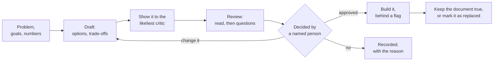

# 9.9 The design process

[Syllabus](../SYLLABUS.md) · Phase 9 · Previous: [9.8 Cost](08-cost.md) · Next: Final capstone *(planned)*

> **Time:** about 30 minutes to read, 40 minutes of practice.
> **You need:** requirements as numbers, from [Chapter 1.1](../phase-1-foundations/01-what-production-demands.md); and the rest of the course, because a design document is where all of it meets. The example needs only Go, and runs at once.

**By the end of this chapter you can**

- say what a design document is for, and when one is not worth writing;
- match the amount of process to how hard a decision is to undo;
- write the parts of a design document, and say which question each one answers;
- state a trade-off so that somebody can disagree with it;
- run a review that tests the design, and not the reader's stamina;
- take a review as an author, and give one as a reviewer;
- leave a record of why a decision was made.

---

## The problem

*An illustrative scenario; the example reproduces its document in miniature.* The design for **ExportHub** was 28 pages long. Nine people came to the review. Two had read to the end. Forty minutes of the hour went on whether Kafka or RabbitMQ was the better queue. Then somebody said that the document looked thorough, and it was approved.

Eight months later, ExportHub is ten services, and 45 copies of them run all day. Exports cost £18,665 a month, and 120 customers use them (Chapter 9.8). Twice in May an export made invoicing slow for everybody. Nobody can say why Kafka was chosen, and the author has left.

Nothing in the document was wrong, exactly. Three things were missing.

1. **The problem.** The document described a solution. It never said how many exports, how large, how soon, or for how much. So there was nothing to test the design against.
2. **A choice.** One option was presented. A decision with one option is not a decision, and nobody was shown what the design gave up.
3. **A review.** The meeting tested stamina. Nobody was asked a question, nobody was named to decide, and the length of the document did the persuading.

---

## The concept

### 1. What a design document is for

It does three jobs.

- **To think.** A fault found in a paragraph costs minutes. The same fault found in a migration costs weeks (Chapter 9.3).
- **To agree.** The people who must live with the design say yes or no while it can still change.
- **To remember.** The reasons outlive the meeting, and the author.

Malte Ubl's account of the practice at Google: "These are relatively informal documents that the primary author or authors of a software system or application create before they embark on the coding project. The design doc documents the high level implementation strategy and key design decisions with emphasis on the trade-offs that were considered during those decisions" ([Malte Ubl, *Design Docs at Google*, 2020](https://www.industrialempathy.com/posts/design-docs-at-google/)).

The third job is the one that the scenario's team misses now. "One of the hardest things to track during the life of a project is the motivation behind certain decisions" ([Michael Nygard, *Documenting Architecture Decisions*, 2011](https://cognitect.com/blog/2011/11/15/documenting-architecture-decisions)). Someone who meets a decision without its reasons, the same article says, can only "Blindly accept the decision" or "Blindly change it".

### 2. How much process? As much as the decision is hard to undo

A document and a review cost time. "Writing design docs is overhead", and whether to write one "comes down to the core trade-off of deciding whether the benefits in organizational consensus around design, documentation, senior review, etc. outweigh the extra work of creating the doc" ([Malte Ubl, *Design Docs at Google*](https://www.industrialempathy.com/posts/design-docs-at-google/)).

The measure to use is how hard the decision is to reverse. Jeff Bezos's advice to Amazon's shareholders: "never use a one-size-fits-all decision-making process. Many decisions are reversible, two-way doors. Those decisions can use a light-weight process" ([Jeff Bezos, *2016 Letter to Amazon Shareholders*](https://www.aboutamazon.com/news/company-news/2016-letter-to-shareholders)).

| The decision | To undo it takes | So |
|---|---|---|
| A cache's lifetime; a library inside one service | An afternoon | Decide. Say why in the pull request |
| A new endpoint for your own callers; a queue between two of your own services | Days | A page, read by the team |
| A data model. A public API. A choice of datastore. A boundary between services. Anything that touches money or personal data | Months, or it cannot be undone | A full document, and a review by the people that it touches |

The last row is this course's list of things that outlive code: Chapters 2.7 and 9.3 for data, 1.4 for a public API, 2.8 for a datastore, 9.5 for a boundary, and Phase 8.

### 3. The parts, and the question that each one answers

| Part | The question | Taught in |
|---|---|---|
| Problem | What hurts, for whom, and how do we know? | Chapter 1.1 |
| Goals and non-goals | How shall we know that it worked? What are we choosing not to do? | |
| Requirements, as numbers | How much, how fast, how available, for how much money? | Chapters 1.1, 9.7 and 9.8 |
| The design | A picture. The API. The data. The path of one request | Phases 1 to 5 |
| Alternatives | What else would work, and why not that? | Section 5 |
| What it is worse at | What do we give up? | Section 5 |
| Failure | What happens when each thing that it depends on is slow, or gone? Who might attack it? | Phase 6, and Chapter 8.1 |
| Operations | How shall we know that it is working, and who is woken when it is not? | Phase 7 |
| Rollout, and undoing it | How does it reach production, and how does it leave? | Chapters 9.2 and 9.3 |
| Cost | What goes on the bill, at launch and at ten times the load? | Chapter 9.8 |
| Open questions | What do we not know yet? | |
| Status, approver, date | Who decides, and by when? | Section 6 |

Two of these are skipped more than the others.

**Non-goals** are "things that could reasonably be goals, but are explicitly chosen not to be goals" ([Malte Ubl, *Design Docs at Google*](https://www.industrialempathy.com/posts/design-docs-at-google/)). They are where a design is kept small. The template that Kubernetes uses for its own proposals gives them a heading of their own, beside the goals ([Kubernetes, *KEP template*](https://raw.githubusercontent.com/kubernetes/enhancements/master/keps/NNNN-kep-template/README.md)).

**Length.** "Design docs should be sufficiently detailed but short enough to actually be read by busy people. The sweet spot for a larger project seems to be around 10-20ish pages" ([Malte Ubl, *Design Docs at Google*](https://www.industrialempathy.com/posts/design-docs-at-google/)). Nygard is blunter: "Nobody ever reads large documents, either" ([*Documenting Architecture Decisions*](https://cognitect.com/blog/2011/11/15/documenting-architecture-decisions)). A document that is too long to read is approved unread.

### 4. Numbers first

A reviewer cannot test *scalable*. A reviewer can test *10,000 exports a day, each ready within 15 minutes*.

- **Write the requirements as numbers** before the design, as Chapter 1.1 did. Every later section is checked against them.
- **Show the arithmetic.** A cost or a capacity in a design is a sum with assumptions in it. Write the assumptions down, because they are what a reviewer should attack.
- **Measure the assumption that matters most.** Chapter 9.8 measured a log line. The example below measures how far a file compresses, because its cost depends on that more than on anything else.
- **Do not wait for certainty.** "most decisions should probably be made with somewhere around 70% of the information you wish you had" ([Jeff Bezos, *2016 Letter to Amazon Shareholders*](https://www.aboutamazon.com/news/company-news/2016-letter-to-shareholders)). What is missing goes in the open questions, with a date and a name.

### 5. Alternatives, and trade-offs said out loud

Every design document needs at least three options: **do nothing**, **the cheapest thing that might work**, and the proposal. A fourth is worth adding: the one that the most senior reviewer is going to suggest.

Ubl on the section that lists them: "this section is one of the most important ones as it shows very explicitly why the selected solution is the best given the project goals" ([*Design Docs at Google*](https://www.industrialempathy.com/posts/design-docs-at-google/)). The Kubernetes template has both of the headings that this section argues for: *Drawbacks*, and *Alternatives* ([*KEP template*](https://raw.githubusercontent.com/kubernetes/enhancements/master/keps/NNNN-kep-template/README.md)).

A **trade-off** has four parts, and a sentence that lacks one of them cannot be argued with.

*We choose X over Y. We get A. We give up B. We would choose Y if C.*

| Cannot be reviewed | Can be |
|---|---|
| Kafka was chosen because it is highly scalable and is the industry standard | New readers must be able to replay a day of events, and a queue that deletes on acknowledgement cannot do that (Chapter 4.4). So we choose a log over the queue that we have. It costs us a cluster to run, and order only within one key. Without the need to replay, we would keep the queue |

The second is longer, and somebody can disagree with it. They can say that nobody needs the replay, and then the decision changes. That is the document working.

Say what the design is worse at, in a section of its own. "A particular decision may have positive, negative, and neutral consequences, but all of them affect the team and project in the future" ([Michael Nygard, *Documenting Architecture Decisions*](https://cognitect.com/blog/2011/11/15/documenting-architecture-decisions)). A design with no stated costs has costs that nobody has looked for.

### 6. The review



**Before.**

- Send the document days ahead, and not hours.
- Name the readers who must answer: the owners of what the design touches. The database's owner, security, whoever is on call for it.
- Name one person who decides.
- Say which decision is being asked for, and by when. Ask the questions that you most want answered.

**At the start, read.** Amazon's meetings begin in silence: "we write narratively structured six-page memos", and "We silently read one at the beginning of each meeting" ([Jeff Bezos, *2017 Letter to Shareholders*](https://www.aboutamazon.com/news/company-news/2017-letter-to-shareholders)). The scenario's review failed before it began, because seven of the nine had not read the document. Reading together removes that failure, and it sets a limit on length that nothing else does.

**During.** Reviewers ask the questions of section 3, problem first. A design for the wrong problem does not need its queue discussed. The Kubernetes project has written its reviewers' questions down, and every proposal has to answer them. Five of them, from the [*KEP template*](https://raw.githubusercontent.com/kubernetes/enhancements/master/keps/NNNN-kep-template/README.md):

- "How can a rollout or rollback fail? Can it impact already running workloads?"
- "What specific metrics should inform a rollback?"
- "Were upgrade and rollback tested? Was the upgrade->downgrade->upgrade path tested?"
- "What are other known failure modes?"
- "What steps should be taken if SLOs are not being met to determine the problem?" (all five are headings in the [same template](https://raw.githubusercontent.com/kubernetes/enhancements/master/keps/NNNN-kep-template/README.md))

They are Phases 6, 7 and 9 of this course, as questions. Google's SREs have the same kind of review under another name, the Production Readiness Review: "a process that identifies the reliability needs of a service based on its specific details" ([Google SRE book, *The Evolving SRE Engagement Model*](https://sre.google/sre-book/evolving-sre-engagement-model/)).

**After.** The decision is written into the document: approved, approved with these changes, or not approved, and why. Each open point has a name beside it. The status line changes.

### 7. Taking a review, and giving one

**As the author.**

- **Find your strongest critic before the meeting.** An objection met in a corridor on Tuesday is a paragraph. Met in the review on Thursday, it is the meeting.
- **Answer in the document.** An answer given aloud is lost. The next reader will ask the same question.
- **Say that you do not know.** It goes in the open questions, and nobody thinks less of the design.
- **Change the design when the objection is right.** A review that changes nothing was not needed.
- **When it will not settle, decide and go on.** Bezos's phrase for it is *disagree and commit*: "This phrase will save a lot of time" ([*2016 Letter to Amazon Shareholders*](https://www.aboutamazon.com/news/company-news/2016-letter-to-shareholders)). It applies to reviewers and to the person who decides alike.

**As a reviewer.**

- **Review the problem before the solution.**
- **Ask for the number.**
- **Mark each comment:** must change, should change, or a question. An author cannot tell ten equal comments apart.
- **Do not redesign it in the meeting.** Say what is wrong, and let the author come back.
- **Say what is good enough.** A reviewer who waits for a perfect design is the slow process of section 2.

### 8. Afterwards: the record

A design document describes a decision at a moment. Afterwards it is one of two things.

- **Kept true.** It is changed when the system changes, and it is the place to read how the thing works.
- **Marked as history.** Its status says *replaced by*, with a link, and it is never deleted. The reasons in it are still the reasons.

For single decisions inside a system, Nygard's form is enough: a short record with a context, the decision, a status and the consequences. "The whole document should be one or two pages long" ([Michael Nygard, *Documenting Architecture Decisions*](https://cognitect.com/blog/2011/11/15/documenting-architecture-decisions)). Keep the records beside the code that they are about.

---

## A real example

### Run it: two documents for one feature, and the sum behind one of them

[`code/ch09-designcheck`](code/ch09-designcheck/) is a program of about 320 lines, and three documents. [`docs/exports-v1.md`](code/ch09-designcheck/docs/exports-v1.md) is the scenario's document, cut down to a page. [`docs/exports-v2.md`](code/ch09-designcheck/docs/exports-v2.md) is a design for the same feature, written as this chapter says. All of it is invented. Read the second one: it is the chapter's real example, and it takes six minutes.

The program asks thirteen things of a document. Its checks are crude on purpose: headings, digits, and a list of words. It cannot tell a good design from a bad one. It finds the documents that cannot be reviewed at all.

```bash
go run ./phase-9-shipping/code/ch09-designcheck
```

```text
PART 1 — two documents for one feature, and what a reviewer needs before the design can be judged.

  docs/exports-v1.md — "ExportHub: next-generation export platform"
    ✗ says what problem it solves                      not in the document
    ✗ has goals, and non-goals                         not in the document
    ✗ gives its requirements as numbers                not in the document
    ✗ shows the design in a picture                    not in the document
    ✗ weighs alternatives, one of them to do nothing   not in the document
    ✗ says what the design is worse at                 not in the document
    ✗ says what happens when things fail               not in the document
    ✗ says how it is rolled out, and undone            not in the document
    ✗ says what it costs                               not in the document
    ✗ lists what is not yet known                      not in the document
    ✗ names who decides, and by when                   not in the document
    ✓ can be read in one sitting                       345 words: about 2 minutes to read
    ✗ claims nothing without a number                  24: scalable ×3, flexible ×2, robust ×2, …
    1 of 13

  docs/exports-v2.md — "Exports: build on request, keep for 30 days"
    ✓ says what problem it solves
    ✓ has goals, and non-goals
    ✓ gives its requirements as numbers                7 of 7 requirements have a number
    ✓ shows the design in a picture
    ✓ weighs alternatives, one of them to do nothing   4 options
    ✓ says what the design is worse at
    ✓ says what happens when things fail               6 failures answered
    ✓ says how it is rolled out, and undone
    ✓ says what it costs
    ✓ lists what is not yet known                      3 questions
    ✓ names who decides, and by when
    ✓ can be read in one sitting                       1,358 words: about 6 minutes to read
    ✓ claims nothing without a number
    13 of 13
```

**The first document passes one check: it is short,** and only because it is an extract. Everything else that a reviewer needs is absent, and 24 words claim something without a number. None of that says that ten services and Kafka are wrong. It says that nobody could tell.

**The second passes all thirteen, and that proves nothing about its design.** What it does mean is that a reviewer can start work. There is a problem with numbers in it, so the design can be held against something. There are four options, so there is a choice to disagree with. There is a section on what the design is worse at, so the costs have at least been looked for.

Notice four things in it.

- **The problem is a number from a bill,** and not a description of a platform.
- **The first alternative is to do nothing,** except for one rule that saves £5,775 a month for a day's work. The document says to do that this week, whatever is decided.
- **The third alternative is the better design, and it is rejected** for now, with the condition under which it would be chosen. That sentence is the one that a future engineer will need.
- **The reviewers are asked questions:** the database's owner about one limit, and security about another.

```text
PART 2 — the arithmetic behind the second document's cost section.

  what it assumes
  exports asked for in a day                                        2,000
  gigabytes in an export before compression, on average              0.69
  times that a file is downloaded, on average                        1.45
  workers running, on average, where 45 run all day today               6
  days that a file is kept, where today it is kept for ever            30

  measured here: 50,000 invoice lines as CSV are 3,618,535 bytes, and 652,511 compressed: 18%

  if real exports shrink to       files  downloads  workers   its share of   a month  for each
                                   kept                      shared things              export
  their full size                   825      4,800      438          3,524     9,587     0.160
  half                              412      2,400      438          3,524     6,774     0.113
  18%, as the sample did            149        866      438          3,524     4,976     0.083
  (today: 18,665 a month, and 0.311 for each export)
```

This is the document's cost section, as arithmetic. The list at the top is what the sum assumes, with Chapter 9.8's prices. The result turns on one thing more, which is how far a file shrinks: £9,587 a month if not at all, and £4,976 if real exports compress as the sample did. So the program measures a sample, and the document says in its open questions that real files will be measured before anything is built. A reviewer who reads only one line of the document should read that one.

The program can be pointed at a document of your own:

```bash
go run ./phase-9-shipping/code/ch09-designcheck my-design.md
```

### How Google, Amazon and Kubernetes do it

| The practice | In their words |
|---|---|
| Write before building, and write the trade-offs | "The design doc documents the high level implementation strategy and key design decisions with emphasis on the trade-offs that were considered during those decisions" ([Malte Ubl, *Design Docs at Google*](https://www.industrialempathy.com/posts/design-docs-at-google/)) |
| Read it together, in silence, first | "We silently read one at the beginning of each meeting" ([Jeff Bezos, *2017 Letter to Shareholders*](https://www.aboutamazon.com/news/company-news/2017-letter-to-shareholders)) |
| Expect the writing to take time | People "mistakenly believe a high-standards, six-page memo can be written in one or two days or even a few hours" ([the same letter](https://www.aboutamazon.com/news/company-news/2017-letter-to-shareholders)) |
| Make every proposal answer the operations questions | "What specific metrics should inform a rollback?" ([Kubernetes, *KEP template*](https://raw.githubusercontent.com/kubernetes/enhancements/master/keps/NNNN-kep-template/README.md)) |
| Use a lighter process for what can be undone | "Many decisions are reversible, two-way doors. Those decisions can use a light-weight process" ([Jeff Bezos, *2016 Letter to Amazon Shareholders*](https://www.aboutamazon.com/news/company-news/2016-letter-to-shareholders)) |

The Kubernetes template is the one to open. It is public, it is in use, and its headings are section 3 of this chapter: a summary, a motivation with goals and non-goals, a proposal with risks, the design, a questionnaire on production readiness, drawbacks and alternatives.

---

## Trade-offs

**Writing against building.** A document delays the first line of code, and saves the weeks spent building the wrong thing. For a change that can be undone in an afternoon, build it.

**Short against complete.** Every section left out is a question that will be asked in the review, or after the incident. Every page added is a reader lost. Put the detail in an appendix, and keep the decision in the first two pages.

**Agreement against a decision.** Waiting until everybody agrees is slow, and it rewards whoever objects longest. One named person who decides is fast, and is sometimes wrong. Record the disagreement, and go on.

**An early review against a late one.** A rough document invites real changes, and looks unfinished. A polished one is hard for its author to change, and reviewers know it.

**A template against thought.** A template makes sure that the questions are asked. It can also be filled in with nothing. An honest *not applicable, because* is a good answer, and a paragraph of filler is not.

**A document kept true against a document kept as history.** Keeping it true costs effort for ever. Marking it as history is free, and leaves the system undescribed. Choose for each document, and say which on its first line.

---

## Practice

### Check yourself

1. You are asked to review a design of 30 pages by tomorrow. What do you do?
2. A document says: *We chose a document database because it is flexible.* What do you need to know before that sentence can be rewritten so that it can be reviewed?
3. Which of these need a full document and a review, and which a paragraph? Adding an index. Changing the primary key of the invoices table. A new public endpoint. Raising a cache's lifetime from 60 seconds to 300. Moving payments into a service of its own.

<details>
<summary>Answers</summary>

1. Read the problem, the goals and the requirements first. If they are missing, say so, and say what is missing: that is a review, and the most useful one that the author can get. If they are there, read the alternatives and the failures next, and the details last. Do not approve what you have not read. Ask who decides, and whether tomorrow is a real date.
2. The requirement that it serves: which data changes shape, and how often? The alternatives: a relational table with a JSON column does much of the same (Chapter 2.8). What is given up: joins, and transactions across documents. And when the other choice would win. With those four, the sentence becomes a trade-off that can be disagreed with. Without them it is an adjective.
3. A paragraph: the index, and the cache's lifetime. Both are undone in minutes, though the index needs the care of Chapter 2.7 when it is built. A full document: the primary key, which every row and every other table depends on; the public endpoint, which outside callers will depend on for years (Chapter 1.4); and the move of payments, which is a boundary and concerns money (Chapter 9.5).

</details>

### Exercise: review a proposal

[`docs/reminders-proposal.md`](code/ch09-designcheck/docs/reminders-proposal.md) is a proposal of 123 words, with faults planted in it.

1. **Run the checker on it,** and read what it says.
2. **Write the review.** Give the three things that must change before it can be approved, in order of importance, each with its reason. Then list your questions.

<details>
<summary>Worked solution</summary>

**1.**

```bash
go run ./phase-9-shipping/code/ch09-designcheck phase-9-shipping/code/ch09-designcheck/docs/reminders-proposal.md
```

```text
  phase-9-shipping/code/ch09-designcheck/docs/reminders-proposal.md — "Reminder emails"
    ✗ says what problem it solves                      not in the document
    ✗ has goals, and non-goals                         not in the document
    ✗ gives its requirements as numbers                not in the document
    ✗ shows the design in a picture                    not in the document
    ✗ weighs alternatives, one of them to do nothing   not in the document
    ✗ says what the design is worse at                 not in the document
    ✗ says what happens when things fail               not in the document
    ✗ says how it is rolled out, and undone            not in the document
    ✗ says what it costs                               not in the document
    ✗ lists what is not yet known                      not in the document
    ✗ names who decides, and by when                   not in the document
    ✓ can be read in one sitting                       123 words: about a minute to read
    ✓ claims nothing without a number
    2 of 13
```

Two of thirteen. Look at the last line. The proposal's whole statement of load is the word *Small*, and the checker passed it, because *small* is not on its list. A reviewer would not have. The program finds what is absent. It does not read.

**2.** A review of it, as it might be written.

*Must change.*

1. **One transaction round the calls to the email provider.** The transaction stays open for as long as the sending takes. For that time it holds a connection, and locks on every overdue invoice, so those invoices cannot be paid or edited (Chapters 2.3 and 2.6). And it does not do what the proposal wants. An email cannot be rolled back. If the job fails after 5,000 emails, the database forgets that they were sent and the customers do not. Send outside the transaction, and record each reminder as it is sent.
2. **Starting again from the beginning.** With the fault above, a failure on Monday sends Monday's reminders again on Tuesday. Each invoice needs a record that its reminder was sent, written with a key that the provider also honours, so that a repeat is harmless (Chapters 1.5 and 4.3).
3. **Trying again until it succeeds.** If the provider is down, the job never ends, and it sends requests as fast as it can to a service that is already in trouble. Limit the tries, wait longer between them, and put what still fails aside to be looked at (Chapters 1.5 and 4.2).

*Questions.*

- How many overdue invoices are there on a normal day, and on the worst day? What rate does the provider allow? *Small* is not a number.
- 09:00 where? Our customers' customers are in more than one time zone. And 09:00 is our own daily peak (Chapter 9.7): which database does the job read?
- What happens when the reporting server is down at 09:00, and who finds out?
- Can a person who receives a reminder stop them? Is that a goal, or a non-goal?
- What else was considered? A queue with one message for each invoice (Chapter 4.2) would give the retries, the limits and the record for nothing.
- How is it switched on? For one customer first, and with a mode that says what it would send and sends nothing?

*What is good.* It is short, and the first two faults could be found in a minute because of that. The author should keep it to a page when the answers are added.

</details>

---

## Production tips and common mistakes

- **Write the problem and the numbers first,** and show them to somebody before designing anything.
- **Give at least three options,** and make one of them to do nothing.
- **Write each trade-off in four parts:** what is chosen, what it gives, what it costs, and when the other choice would win.
- **Have a section for what the design is worse at.**
- **Answer the operations questions in the document:** how it fails, how it is watched, how it is rolled out and how it is undone.
- **Put a cost in it,** and the assumption that the cost depends on.
- **Keep the decision in the first two pages.**
- **Name the readers who must answer, and the one who decides.**
- **Begin the review by reading.**
- **Record the decision in the document,** with the objections that were not accepted.
- **Match the process to the door.** A page for what can be undone, and a review for what cannot.
- **Mark a document as replaced, and never delete it.**

Common mistakes:

- **A document that starts with the solution.**
- **Adjectives where the numbers should be.**
- **One option.**
- **A design with no stated costs.**
- **Twenty-eight pages, and a one-hour meeting.**
- **A review of the queue, before anybody has asked what the problem is.**
- **Approval by tiredness.**
- **A decision that lives only in the memory of the people who were in the room.**
- **A template filled in with nothing.**
- **The same heavy process for every change.**

---

## Key takeaways

- A design document is for thinking, agreeing and remembering. It is worth its cost when the decision is hard to undo.
- Its parts are questions: what hurts, how much, what else would work, what we give up, how it fails, how it is run, how it is undone, what it costs, and what we do not know.
- Requirements are numbers. A sum shows its assumptions, and the assumption that matters most is measured.
- A trade-off says what is chosen, what it gives, what it costs, and when the other choice would win. Then somebody can disagree.
- A review starts with reading, tests the problem before the solution, and ends with a decision by a named person, written down.
- The record of why outlasts the code and the people. Keep it.

**Next:** Final capstone *(planned)* — one system, from the requirements to the bill, with everything in the nine phases: a ride-hailing backend, written as a design document.

---

## Sources

- Malte Ubl, [*Design Docs at Google*](https://www.industrialempathy.com/posts/design-docs-at-google/), 2020.
- Michael Nygard, [*Documenting Architecture Decisions*](https://cognitect.com/blog/2011/11/15/documenting-architecture-decisions), Cognitect, 2011.
- Jeff Bezos, Amazon: [*2016 Letter to Amazon Shareholders*](https://www.aboutamazon.com/news/company-news/2016-letter-to-shareholders); [*2017 Letter to Shareholders*](https://www.aboutamazon.com/news/company-news/2017-letter-to-shareholders).
- Kubernetes, [*KEP template*](https://raw.githubusercontent.com/kubernetes/enhancements/master/keps/NNNN-kep-template/README.md), the template for Kubernetes Enhancement Proposals.
- Google, *Site Reliability Engineering*, 2016: [*The Evolving SRE Engagement Model*](https://sre.google/sre-book/evolving-sre-engagement-model/).
