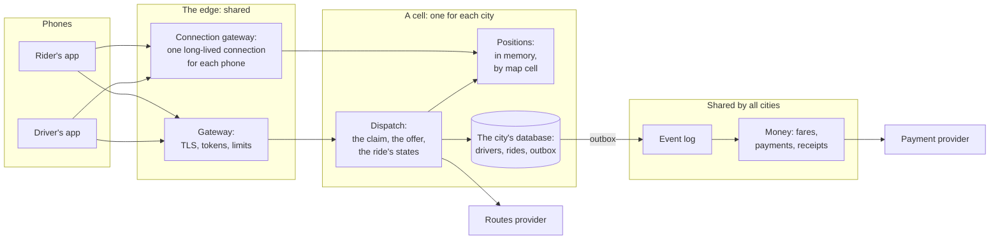

# Capstone 9: a ride-hailing backend, end to end — every promise has one place that keeps it

[Syllabus](../SYLLABUS.md) · Phase 9 · Previous: [9.9 The design process](09-the-design-process.md)

> **Time:** three hours for your own design, then an hour with the worked one.
> **You need:** the whole course. The reference implementation needs only Go, and runs in about five seconds.

This is the last page of the course, and it has no new idea in it. It asks for one system, from the first question to the bill, written as the design document of Chapter 9.9.

The system is a ride-hailing service: riders ask, drivers are found, cars are followed on a map, and money changes hands. It was chosen because every phase of the course has a part in it. Requests that must be answered in time (Phase 1). Rows that two requests must not both win (Phase 2). Reads that are far more frequent than writes, and data that is stale within seconds (Phase 3). Work that must happen after the answer, exactly once in effect (Phase 4). A choice of what must be consistent and what need not be (Phase 5). Dependencies that fail, and a failure that must stay in one city (Phase 6). Promises that have to be measured (Phase 7). Other people's locations and money (Phase 8). And four teams who must ship it, a few times a day, for less than three pence a ride (Phase 9).

The hard part of a system like this is not any one of those. It is knowing which few parts are hard, and keeping the rest plain.

**How to use this page**

1. Read the brief.
2. Write your own design, on paper, against the task list. Give yourself a time limit.
3. Only then open the worked design and compare, section by section.
4. Run the reference implementation — and then run it with safeguards removed.

---

## The brief

*From the CTO of a company that does not exist.*

> We launch in five cities in the spring, and want twenty within a year. I need a design that I can take to the board, and that four teams can build.
>
> **What the product does**
> - A rider opens the app, sees roughly where the cars are, and asks for a ride from one place to another.
> - We find a driver. The driver's app shows the offer, and the driver has eight seconds to accept it.
> - Both apps follow the car on a map until the ride ends. The rider pays by card and gets a receipt.
>
> **The numbers**
> - 300,000 rides a day across the five cities. The largest city has four in ten of them.
> - The busiest hour is eleven to midnight on a Friday, with a tenth of the day's rides. New Year's Eve is four times a Friday.
> - 40,000 drivers are online at that peak. A driver's phone reports its position every 4 seconds.
> - 200,000 riders have the app open at that peak, and it refreshes its map every 5 seconds.
> - A car takes 6 minutes to arrive, on average, and a ride lasts 18.
> - One outside company gives us routes and arrival times, at £0.004 a request. Another takes the card payments. It answers within 2 seconds 99 times in 100, and fails or times out about once in 200.
> - Old versions of both apps stay in use for six months. We cannot make people update.
>
> **What must be true**
> 1. A driver is never given two rides at once, and a ride never has two drivers.
> 2. A rider who asks is told yes or no within 30 seconds.
> 3. We never match on a position that is more than 15 seconds old.
> 4. A ride that has started is never lost. We can always work out its fare.
> 5. A rider is charged once for a ride, and a driver is paid once.
> 6. A rider sees only their own rides. A driver's exact position is shown only to the rider whom they are carrying, or going to.
> 7. Asking for a ride works 99.95% of the time in each city, over a month. Trouble in one city does not reach another.
> 8. The infrastructure costs less than 3p a ride.
>
> **Constraints**
> - Twenty-five engineers, in four teams.
> - One cloud provider, with a region near each city. Each region has three zones.

---

## Your task

Write a design document of four or five pages. The suggested times add up to three hours.

| # | Deliverable | Draws on | Time |
|---|---|---|---|
| 1 | Questions for the CTO. Goals and non-goals. For each thing that must be true, the place that keeps it | 1.1, 9.9 | 15 min |
| 2 | Estimates: rides, positions, map refreshes, connections and storage, on a Friday and on New Year's Eve. Which parts are large | 1.1, 1.7, 9.7 | 15 min |
| 3 | The API, and the states of a ride | 1.3–1.5 | 15 min |
| 4 | Data: what is kept where, and why. The ride's table | Phase 2 | 20 min |
| 5 | **Positions and matching**: the index, the candidates, the claim, the offer | Phases 2, 3 and 5 | 25 min |
| 6 | What happens after the answer: events, payments, receipts | Phase 4 | 15 min |
| 7 | Reaching the phones, and what a phone does when it cannot be reached | 3.7 | 10 min |
| 8 | Failure: each dependency slow or gone, a zone, a region, too many requests | Phase 6 | 20 min |
| 9 | Operating it: objectives, alerts, and what the person on call sees | Phase 7 | 10 min |
| 10 | Security: the boundaries, who may read what, locations, the fare | Phase 8 | 15 min |
| 11 | Shipping it: services and teams, rollout, old apps, capacity for New Year's Eve, the cost of a ride. What the design is worse at | Phase 9 | 20 min |

The two standing rules:

- **Every number has a source**: the brief, arithmetic you show, or an assumption you label.
- **Choose.** Pick an option, give the reason, and name what you gave up.

And one for this capstone:

- **For every thing that must be true, name the one place that makes it true, and say what happens to it when that place is slow or gone.** A promise that is kept in three places is kept in none of them. A promise with no place is the first thing that will break.

---

## Worked design

<details>
<summary>Open only after you have written your own</summary>



### 1. Questions, goals, and the place for each promise

**Questions that change the design.**

- *May a rider wait for a car to become free, or do we say no at once?* Assumed: we look for up to 25 seconds, and then say no. That is what promise 2 allows.
- *Is an offer made to one driver at a time, or to several?* Assumed: one at a time. Section 5 says what that costs.
- *Does a ride ever cross from one city to another?* Assumed: a ride belongs to the city where it starts. This is the assumption that the whole shape rests on.
- *Who owns the fare?* Assumed: we do, from our own record of the journey, and never from what a phone says the fare was.

**Goals.** The eight promises of the brief. **Non-goals:** shared rides, rides booked for later, anything a driver does that is not a ride, and the choice of fare. Each would change the data model, and none is in the brief.

**The place for each promise.** This table is the design. The rest is detail.

| # | Must be true | The one place that keeps it | When that place is slow or gone |
|---|---|---|---|
| 1 | One driver, one ride | A conditional write in the city's database (section 5) | No new matches in that city. Never two |
| 2 | An answer within 30 seconds | Dispatch's own deadline of 25 seconds, and its door (sections 5 and 8) | The gateway answers no at 30 seconds |
| 3 | No position older than 15 seconds | The time on each position, checked when it is read | No candidates, so riders are told no. Phones refill it within 4 seconds |
| 4 | A started ride is never lost | The ride's row, written before the driver is told to go. The journey is kept on the phone until we confirm that we have it | The phone holds the journey, and sends it later |
| 5 | Charged once, paid once | The ride's number, used as the key of the payment. An outbox (section 6) | Charges wait. Nobody is charged twice |
| 6 | Only your own rides | One check in the API, on the ride's rider and its driver (section 10) | It refuses |
| 7 | 99.95% in each city, and no spreading | A cell for each city (section 8) | The other cities do not notice |
| 8 | Under 3p a ride | A count of route requests for each ride, limited in code, and the cost of a ride on a dashboard (section 11) | |

### 2. Estimates

| What | The sum | The result |
|---|---|---|
| Rides, on average | 300,000 ÷ 86,400 | 3.5 a second |
| Rides, Friday's peak hour | 30,000 ÷ 3,600 | 8.3 a second |
| Rides, New Year's Eve | × 4 | 33 a second |
| Positions written | 40,000 drivers ÷ 4 s | **10,000 a second** |
| Positions held | 40,000 × about 100 bytes (assumed) | 4 MB |
| Map refreshes | 200,000 riders ÷ 5 s | **40,000 a second** |
| Rides under way at the peak | 30,000 an hour × 24 minutes ÷ 60 | 12,000 |
| Phones connected at the peak | 40,000 + 200,000 | **240,000** |
| Ride records | 300,000 a day × 2 KB (assumed) | 0.6 GB a day, 220 GB a year |
| Journeys | 24 minutes × 15 points × 50 bytes (assumed) = 18 KB a ride | 5.4 GB a day, 2 TB a year |
| Payments that need a second try | 300,000 ÷ 200 | 1,500 a day |
| Minutes a city may be down | 43,200 in 30 days × 0.0005 | 21.6 a month |

**What this says.** Three flows are large, and they are in bold: positions, map refreshes and connections. Everything to do with a ride itself is small. Eight rides a second is a small load for one database. So the ride's data can be kept in the plainest and safest way that we know, and the engineering goes into the three large flows, none of which needs to be durable.

That is the most important sentence in the design. A ride-hailing system is not a large database problem.

### 3. The API, and the states of a ride

| Who | Request | Notes |
|---|---|---|
| Rider | `POST /rides` | With an `Idempotency-Key` (Chapter 1.5). Answers `201` with the ride, or `503` with `Retry-After` when dispatch is full |
| Rider | `GET /rides/{id}` | The rider's own rides only (section 10) |
| Rider | `POST /rides/{id}/cancel` | |
| Driver | `POST /rides/{id}/accept`, `/decline` | Answers `409` if the offer has gone |
| Driver | `POST /rides/{id}/arrived`, `/start`, `/finish` | Each is safe to send twice |
| Both | One long-lived connection | Positions go up. Offers and the car's position come down (section 7) |

A ride moves through six states, and every move is one conditional write (Chapter 2.3).

| From | To | Caused by | The write's condition |
|---|---|---|---|
| asked | matched | The driver accepts | The ride is still *asked*, and on offer to this driver |
| matched | arriving | The driver sets off | The ride is *matched*, to this driver |
| arriving | riding | The driver starts the ride | The same |
| riding | finished | The driver ends it | The same. The fare and an event are written with it |
| asked, matched, arriving | cancelled | The rider, the driver, or dispatch giving up | The ride is in one of those states |

**Old apps (Chapter 9.3).** A phone may be six months behind. So a state is never renamed or removed, and an app that meets a state that it does not know shows the ride as *in progress*. That rule is in the first version of both apps, because it cannot be added later.

### 4. Data: what is kept where

| Data | Where | Why |
|---|---|---|
| Drivers' positions | Memory, in the city's cell. Two copies, in two zones | 10,000 writes a second of data that is worthless after 15 seconds. Lost data is replaced by the phones in 4 seconds |
| Rides, and which ride holds each driver | PostgreSQL, one for each city: a primary, and a standby in another zone that confirms each write (Chapter 5.1) | Small, precious, and needs transactions |
| Journeys: the points of a ride | Appended to the event log, then to object storage. The phone keeps its copy until we confirm | 2 TB a year, written once and seldom read (Chapter 2.8) |
| Accounts, cards' tokens, fares, payments | One database shared by all cities | A rider is not in a city |
| Arrival times between map cells | A cache, for 60 seconds (Chapter 3.3) | Each one costs £0.004 to compute |

The database for a city is a decision that is hard to undo, so it gets its alternatives.

| Option | For | Against |
|---|---|---|
| One database for all cities | Simplest. One thing to run | One failure, or one bad migration, stops every city. Promise 7 fails |
| A distributed database, spread over regions | Survives the loss of a region | Every claim pays for agreement between regions (Chapter 5.6), and it is more than eight rides a second needs |
| **A database for each city** | A city is a cell. A migration is tried on the smallest city first | Twenty databases to run. A question about all cities is asked of the event log, and not of a database |

A ride, a driver's status and the outbox are in the same database, because they change in the same transactions. The statements here and in the next two sections were run on PostgreSQL 16, and changed the rows that the text says they change:

```sql
CREATE TABLE drivers (
    id       bigint PRIMARY KEY,
    ride_id  bigint            -- the ride that holds this driver, or NULL
);
CREATE TABLE rides (
    id          bigint PRIMARY KEY,
    rider_id    bigint      NOT NULL,
    driver_id   bigint      REFERENCES drivers (id),
    offered_to  bigint      REFERENCES drivers (id),
    state       text        NOT NULL DEFAULT 'asked'
                CHECK (state IN ('asked', 'matched', 'arriving', 'riding', 'finished', 'cancelled')),
    asked_at    timestamptz NOT NULL DEFAULT now(),
    fare_pence  integer
);
CREATE INDEX ON rides (rider_id, asked_at DESC);
CREATE TABLE outbox (
    id       bigserial PRIMARY KEY,
    ride_id  bigint NOT NULL REFERENCES rides (id),
    kind     text   NOT NULL,
    body     jsonb  NOT NULL
);
```

### 5. Positions and matching

**The index.** A city is divided into cells, and the index keeps, for each cell, the drivers who last reported from it. H3 is one such division: "a geospatial indexing system that partitions the world into hexagonal cells" ([H3 documentation](https://h3geo.org/docs/)). Finding drivers near a rider is then a matter of reading the rider's cell and the rings of cells round it.

Grab describes its own store of drivers' positions in the same terms: "a scalable in-memory solution that supports large-volume, real-time K nearest search by driving distance or ETA with high object update frequency". It is divided as this design is: "maps are partitioned by cities and we assume that drivers of a city operate within that city". And it has copies, as this one has: "each model has two replicas and they are stored on different instances and different availability zones" (all three from [Grab Tech, *Pharos - Searching Nearby Drivers on Road Network at Scale*](https://engineering.grab.com/pharos-searching-nearby-drivers-on-road-network-at-scale)).

| Option for the index | For | Against |
|---|---|---|
| The city's database, with a spatial index | One system | 10,000 durable writes a second, of data that has no need to be durable |
| A shared cache with geospatial commands, such as Redis's, which can "Return the members of a sorted set populated with geospatial information" within an area ([Redis documentation, *GEOSEARCH*](https://redis.io/docs/latest/commands/geosearch/)) | Already built. Quick to adopt | No time on each member, so staleness needs a second structure. One more system for each cell |
| **Our own, in the memory of the positions service** | The position, its time and the driver's cell in one place. 4 MB | Ours to build and to run. Two copies must both be written |

**The candidates.** The nearest drivers by cell, whose positions are less than 15 seconds old. The time is checked when the position is read, and again just before an offer, because dispatch may have spent 16 seconds on two other drivers in between. Then one request to the routes provider gives the arrival time for the driver who is chosen. The same article explains why distance in a straight line is not enough for that: nearest drivers by it "may incur long driving distance and ETA" ([Grab Tech, *Pharos*](https://engineering.grab.com/pharos-searching-nearby-drivers-on-road-network-at-scale)).

**The claim.** This is promise 1, and it is two conditional writes (Chapter 2.3).

```sql
-- hold the driver, if nobody else holds them
UPDATE drivers SET ride_id = 101 WHERE id = 7 AND ride_id IS NULL;

-- the driver accepts: the ride is theirs only if it is still on offer to them
UPDATE rides SET state = 'matched', driver_id = 7
 WHERE id = 101 AND state = 'asked' AND offered_to = 7;
```

Each either changes one row or changes none, and dispatch acts on the count. Two copies of dispatch that want the same driver both send the first statement, and the database lets one of them change the row. A driver who accepts an offer after it has been taken back sends the second, and it changes nothing. There is no lock held while a driver thinks, and no step at which two people can both believe that they have won.

**The offer.** A driver has 8 seconds, or the time that the request has left if that is less (Chapter 6.2). When the time is up, the claim is released and the next driver is tried. At 25 seconds dispatch stops, and the rider is told no.

**One at a time, or several?** Offering to three drivers at once finds a driver sooner. Two of the three then see an offer vanish. The conditional write makes either correct, so the choice is about drivers' patience and not about consistency. This design offers to one, and would change if the time to match were the complaint.

### 6. After the answer

The end of a ride is one transaction in the city's database: the ride becomes *finished*, the driver becomes free, and a row is added to the outbox (Chapter 4.5).

```sql
BEGIN;
UPDATE rides SET state = 'finished', fare_pence = 1250
 WHERE id = 101 AND state IN ('matched', 'arriving', 'riding');
UPDATE drivers SET ride_id = NULL WHERE id = 7 AND ride_id = 101;
INSERT INTO outbox (ride_id, kind, body) VALUES (101, 'ride.finished', '{"fare_pence": 1250}');
COMMIT;
```

A relay publishes outbox rows to the event log, at least once (Chapter 4.3). Four readers take them: payments, receipts, the driver's earnings, and analysis.

**The payment** uses the ride's number as its key, so that a second delivery, or a second try after a lost answer, charges nothing more (Chapter 1.5). A charge that still fails after its tries is put aside, and a person is told (Chapter 4.2). Once a day our record is compared with the provider's (Capstone 6).

**What is not asynchronous:** the claim and the match. The rider is waiting, and the answer is the write.

### 7. Reaching the phones

Each phone holds one long-lived connection to a connection gateway (Chapter 3.7). Positions go up on it. Offers, and the car's position during a ride, come down.

- **The gateway keeps no state that matters.** It knows which phone is on which connection, and no more. When a copy is replaced, its phones reconnect to another, at random moments within a few seconds and not all at once (Chapters 3.7 and 9.1).
- **An offer must reach a phone that has no connection.** It is also sent as a push notification. The offer's 8 seconds run on our clock, and not on the phone's.
- **A phone that cannot reach us keeps working.** The driver's app records the journey, and sends it when it can. That is half of promise 4.
- **The map does not need the truth.** The cars that a rider sees before asking are a rough count for each cell, cached for a few seconds (Chapter 3.3). That turns 40,000 refreshes a second into a few thousand reads of the index.

### 8. Failure

| When | What happens | Why that is acceptable |
|---|---|---|
| The positions index is lost | No candidates, and riders are told no. It is full again within 4 seconds, from the phones | Nothing was promised to be durable |
| The city's primary database fails | The standby takes over, within seconds if that is automatic (Chapter 5.1). Until then no ride can be asked for or accepted. Rides under way continue, on the phones | It spends a little of the month's 21.6 minutes. No promise about data is broken, because the standby had every write |
| The routes provider is slow or down | A breaker opens (Chapter 6.3). Arrival times come from our own table of speeds between cells | A worse estimate is better than no ride |
| The payment provider is down | Rides end as usual. Charges wait in the event log, and are made when it returns | Promise 5 is about *once*, and not about *now* |
| A zone is lost | Each service has copies in three zones, with room to lose one (Chapter 9.7). The database's standby is in another zone | |
| A region is lost | That city stops. The others do not notice | See below |
| More requests than dispatch can work on | The door says so at once, with `Retry-After` (Chapter 6.4). The apps wait, with jitter, before asking again | A quick no is promise 2. A slow no is not |
| Every phone reconnects at once | The connection gateway limits new connections a second, and the apps back off (Chapter 3.7) | |

**The cell.** Each city has its own positions, its own dispatch, its own database, and its own limits (Chapter 6.5). Nothing in one city's cell is called by another's. The shared parts are the edge, which holds no state, and money, which no rider is waiting for.

**The region is the decision to argue about.** A city's cell lives in one region. If that region fails, the city is down until it returns, and one such day uses years of the 21.6 minutes. The alternative is a second copy of each city's database in another region, with all that Chapter 6.6 says about it. This design does not build that for the launch. It keeps a copy of each database's log in a second region, so that nothing is lost, and it accepts that bringing a city up elsewhere would take hours. That is a risk to promise 7, it is written here, and the CTO signs it.

### 9. Operating it

| Objective (Chapter 7.2) | Target | Measured |
|---|---|---|
| A request for a ride is answered, yes or no, within 30 seconds | 99.95% over 28 days, for each city | At the gateway |
| A rider who is told yes was told within 10 seconds | 90% | In dispatch |
| A position is under 15 seconds old when it is used | 100%, by construction. Alert on the age of the oldest | In dispatch |
| A finished ride is charged within an hour | 99.9% | In money |

- **Pages** (Chapter 7.3): the first objective burning its budget fast, for any city; the outbox's oldest row older than five minutes; charges put aside.
- **The first screen for the person on call:** one row for each city, with requests, answers within 30 seconds, drivers online, the age of positions, and offers accepted. A city that is in trouble is a row that looks different from the others.
- **A trace** (Chapter 7.4) follows a request from the gateway through dispatch to the offer, and the ride's number is on every log line.

### 10. Security

| What could go wrong (Chapter 8.1) | What stands in the way |
|---|---|
| A rider reads another rider's ride, by changing a number in the URL | One check, in one place: the caller is the ride's rider or its driver (Chapter 8.3). Ride numbers are random, which hides the count and proves nothing |
| Somebody follows a driver | Before a match, a rider gets a rough count for a cell, and never a driver's identity or exact position. After it, the exact position, for that ride only, until it ends |
| A rider and a driver keep each other's phone numbers | Calls and messages go through a number that we lend for the ride |
| A phone reports a fare, or a route, that is not true | The fare is worked out by us, from the journey as we recorded it. Positions that jump are marked for a person to look at. Some false positions will get through, and that is accepted, and watched |
| A stolen token | Short-lived tokens, renewed in the background, and withdrawn within minutes (Chapter 8.2). A driver's token is tied to one phone |
| A member of staff looks up a well-known rider | Access to a ride by staff needs a reason, and is written to a log that staff cannot change (Chapter 8.6) |
| The journeys themselves | They are personal data of the most revealing kind. They are encrypted, kept for as long as a fare can be disputed, and then deleted (Chapters 8.4 and 9.8) |

### 11. Shipping it

**Services and teams (Chapter 9.5).** Five services, for four teams. Each can be deployed alone.

| Team | Owns |
|---|---|
| Edge | The gateway and the connection gateway |
| Marketplace | Positions. Dispatch, with each city's database |
| Money | Fares, payments, receipts, earnings. Accounts |
| Platform | The clusters, the pipeline, the telemetry, and each cell as a thing that can be created from code (Chapter 9.4) |

Dispatch and the ride's states are one service, because the claim, the match and the end of a ride are transactions on one database. Splitting them would put a network call inside promise 1.

**Rollout (Chapter 9.2).** A city is the unit. A new build of dispatch goes to the smallest city, then to two more, then to all, and it is judged at each step against the cities that have not yet had it. A change to a table is made in three steps (Chapter 9.3), for each city in turn.

**Capacity (Chapter 9.7).** Friday's peak and New Year's Eve are known, so they are on a schedule. Before the first New Year's Eve the whole of one cell is tested at four times a Friday, with the largest city's numbers: 13 rides a second, its 16,000 drivers reporting, and half a minute in which every phone reconnects.

**The cost of a ride (Chapter 9.8).** With the invented prices of Chapter 9.8, and 9 million rides a month:

| Line | The sum | A month |
|---|---|---|
| Copies of services | 60 on average × 730 hours × £0.10 | £4,380 |
| Databases: a primary and a standby for each city, and for money | 14 units × 730 × £1.50 | £15,330 |
| Journeys kept | 2,000 GB × £0.02, after a year | £40 |
| Logs, metrics and traces | Assumed | £3,000 |
| **Infrastructure** | | **£22,750: 0.25p a ride** |
| Routes | 2 requests a ride × £0.004 | 0.8p a ride |
| **Together** | | **about 1p a ride** |

Routes are three quarters of the cost, and they are the line that a design can lose control of. One request for each of ten candidates, and a new route every minute of a 24-minute journey, would be 34 requests and 13.6p. So the number of route requests for a ride is limited in code to two: one arrival time for the chosen driver, and one route for the ride. That limit is the place that keeps promise 8.

**What this design is worse at.**

- A ride cannot cross between two cities' cells. A rider at the edge of one city is offered only that city's drivers.
- A question about all cities cannot be asked of a database. It waits for the event log.
- Twenty cities are twenty databases to upgrade.
- The loss of a region stops a city for hours.

**What breaks first, as it grows.**

1. The largest city's positions, when one process can no longer hold a city. The index is then divided by district.
2. The connection gateways, on a night when every phone reconnects.
3. The shared edge. It is the one part that every city depends on, and it wants a cell of its own for each region.
4. The single database for money.

</details>

---

## Reference implementation

[`code/capstone-rides`](code/capstone-rides/) is four files and about 740 lines. It is a miniature of sections 5, 6 and 8: two cities, each a cell with its own index, store, dispatch and door.

**What is real:** the claim on a driver, the offer and its time limit, the states of a ride, the outbox and its relay, the payment and its key, and the check on who may read a ride. They run concurrently, as copies of a service do, and they race as copies of a service do. **What is a model:** the drivers, the riders and the payment provider. The store is in memory, where the design has a database: it makes the same conditional writes. Time is compressed, so that one second in the city takes 10 ms.

Things go wrong on purpose. Eight phones in a hundred go silent, without a word. Of every hundred offers, eight are never answered, four are declined, and five are accepted after they have run out. The process dies once in twelve times between ending a ride and anything that follows. The relay publishes one batch in five twice. The payment provider loses one answer in twelve, after taking the money. And at two minutes a stadium empties in the south, and eight times as many people ask for rides.

```bash
go run ./phase-9-shipping/code/capstone-rides
```

```text
Two cities of 150 drivers, for five minutes. At 2:00 a stadium empties in the south.
Removed: nothing.

  city        asked   given a driver    told no    turned away     median   slowest 1%
                                                   at the door     answer   of answers
  north         489       488 (100%)          1              0      2.2 s       18.2 s
  south         825       521 ( 63%)         20            284      2.0 s       25.1 s

  what must be true                                                    broken
  a driver has one ride at a time                                           0
  a ride has one driver                                                     0
  every rider is answered, within 30 seconds                                0
  no offer goes to a driver who has been silent for 15 seconds              0
  no driver is left held for a ride that never came                         0
  a city that is not busy turns nobody away                                 0
  every finished ride is charged                                            0
  no ride is charged twice                                                  0
  nobody reads a ride that is not theirs                                    0

  rides finished: 1009   charges made: 1009
```

Nine things must be true, and none is broken. The numbers above them change a little from one run to another, because the races are real. The zeros do not.

Look at the south. A third of those who asked were turned away at the door, at once, because there were no cars for them. That is not a fault. It is promise 2 being kept in the only way that it can be, and the north did not notice.

### Remove one safeguard at a time

Each of these takes away one line of the design, and shows which promise it was holding up. The program exits with status 1 when anything is broken.

```bash
go run ./phase-9-shipping/code/capstone-rides -without claim
```

```text
  a driver has one ride at a time                                         209
  a ride has one driver                                                    47
```

The claim is now two statements: look, and then write. Two copies of dispatch look at the same driver in the same millisecond, and both write. This is the lost update of Chapter 2.3, and here it is two riders waiting for one car. The second line is the same fault from the other side: a driver who accepts late now takes a ride that has since gone to somebody else.

```bash
go run ./phase-9-shipping/code/capstone-rides -without fresh
```

```text
  no offer goes to a driver who has been silent for 15 seconds            175
```

Without the time on each position, a phone that went silent stays where it was last seen, and it is the nearest car to somebody. Every one of those offers waits its full 8 seconds for nobody. This is a cache with no expiry (Chapter 3.3).

```bash
go run ./phase-9-shipping/code/capstone-rides -without offer-timeout
```

```text
  north         489       186 ( 38%)          0            267      0.0 s       11.1 s
  south         825       339 ( 41%)          0            450      0.0 s       16.3 s
```

```text
  every rider is answered, within 30 seconds                               72
  no offer goes to a driver who has been silent for 15 seconds              0
  no driver is left held for a ride that never came                        48
  a city that is not busy turns nobody away                               267
```

This one stops both cities. With no limit on an offer, each driver who never answers holds one of dispatch's 24 places for ever. Within minutes every place in each city is waiting for somebody who is not there. The door is then always full, and it turns away riders in a city with cars to spare. It is Chapter 1.5's first rule: the default is to wait for ever, and a pool of anything that waits for ever is soon empty.

```bash
go run ./phase-9-shipping/code/capstone-rides -without cells
```

```text
  north         489       473 ( 97%)          2             14      2.1 s       19.2 s
  south         825       526 ( 64%)         47            252      2.1 s       25.1 s
```

```text
  a city that is not busy turns nobody away                                14
```

The two cities now share one door and one set of places. When the stadium empties in the south, the north's riders are turned away, in a city that had cars. Nothing was broken in the north. It was only standing next to the south (Chapter 6.5).

```bash
go run ./phase-9-shipping/code/capstone-rides -without outbox
```

```text
  every finished ride is charged                                           83
  no ride is charged twice                                                  0
  nobody reads a ride that is not theirs                                    0

  rides finished: 1007   charges made: 924
```

The ride and its event are two writes, and the process sometimes dies between them. The ride is finished, the rider has gone home, and nothing ever tells payments. These rides are free (Chapter 4.5).

```bash
go run ./phase-9-shipping/code/capstone-rides -without idempotency
```

```text
  no ride is charged twice                                                279
  nobody reads a ride that is not theirs                                    0

  rides finished: 1006   charges made: 1319
```

The outbox delivers at least once, and the provider sometimes takes the money and loses the answer. Without a key, each of those is a second charge (Chapters 1.5 and 4.3). Note that this fault is only visible because the outbox is doing its work.

```bash
go run ./phase-9-shipping/code/capstone-rides -without owner-check
```

```text
  nobody reads a ride that is not theirs                                  200
```

Two hundred requests for somebody else's ride, and two hundred answers (Chapter 8.3). Nothing else in the system notices, which is how this fault lasts for years.

---

## Review your own design

- [ ] Did you find the **three large flows**, and notice that rides are not one of them?
- [ ] Are positions kept **out of the durable database**?
- [ ] Is "one driver, one ride" **one conditional write**, and not a check followed by a write?
- [ ] Is a **late acceptance** refused by the same kind of write?
- [ ] Does every wait have a **limit**, and does an offer get only the time that the request has left?
- [ ] Is a position's **age** checked where it is used?
- [ ] Are the end of a ride and its event **one transaction**?
- [ ] Does the payment carry a **key**, and is there a daily comparison with the provider?
- [ ] Can a ride **finish while the payment provider is down**?
- [ ] Is each city a **cell**, with nothing in it that another city calls?
- [ ] Did you say what happens when a **region** is lost, and who accepted it?
- [ ] Is the door's answer under load a **quick no**?
- [ ] Does an **old app** survive a state that it does not know?
- [ ] Is there **one check** on who may read a ride, and a rule for exact positions?
- [ ] Is the fare worked out **by you**, from your own record?
- [ ] Are there as many **services as you can staff**, and no more?
- [ ] Is the **cost of a ride** a number, with its largest line named?
- [ ] For each of the eight promises, can you point to **one place**?
- [ ] Did you write down what the design is **worse at**?

---

## Extensions

1. **Offer to three drivers at once.** Change dispatch so that it claims and offers to three, and the first acceptance wins. Check that the nine zeros hold, and compare the time to a match.
2. **Lose a city's database.** Stop one city's store for 30 seconds of the city's time, and bring it back. Say which promises were kept, and how many of the month's 21.6 minutes were spent.
3. **Divide a city.** Split the north's index into four districts, each held by a different process, and decide what a rider on a boundary is offered.
4. **Rides that are booked for later.** They were a non-goal. Write the page that makes them a goal: what changes in the data, and which promise needs a new place.
5. **A second region.** Write the alternative to section 8's accepted risk as a design document of one page, with its cost.
6. **Review somebody else's.** Exchange designs with another reader, and review theirs as Chapter 9.9 describes: the problem first, three things that must change, and then questions.

---

## Sources

- H3 documentation, [*Introduction*](https://h3geo.org/docs/).
- Hao Wu and five others, [*Pharos - Searching Nearby Drivers on Road Network at Scale*](https://engineering.grab.com/pharos-searching-nearby-drivers-on-road-network-at-scale), Grab Tech, 2020.
- Redis documentation, [*GEOSEARCH*](https://redis.io/docs/latest/commands/geosearch/).

Everything else in the worked design is from the chapters that it names, and their sources are listed there.

---

**That is the course.** It began with one server and a list of questions, and it ends with a system that nobody could hold in their head, held on five pages by asking the same questions in the same order: what must be true, how much, where is each promise kept, what happens when that place fails, how is it changed, and what does it cost.

Three things are worth doing next. Go back to [Capstone 1](../phase-1-foundations/capstone-url-shortener.md) and write it again; it will take a quarter of the time, and the design will be different. Read the reports that companies publish after their outages, and for each ask which promise had no place. And the next time a design is put in front of you, ask for the number.
