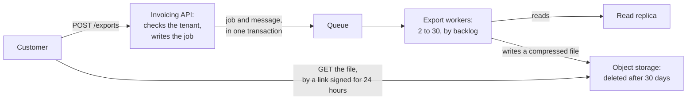

# Exports: build on request, keep for 30 days

*A model document for Chapter 9.9. The product, the numbers and the people are invented; the numbers are those of the bill in Chapter 9.8.*

- **Status:** in review
- **Author:** the exports team
- **Reviewers who must answer:** the owner of the main database; security; the on-call lead for invoicing
- **Approver:** the head of engineering
- **Decision needed by:** 14 June

## Problem

Exports are CSV files of a customer's invoices. They cost £18,665 a month, which is 30% of the bill, and 120 of our 4,000 customers use them (Chapter 9.8, part 2). Three things cause the cost and one of them causes outages.

1. Files are never deleted. We keep 330,000 GB of them.
2. Forty-five workers run all day for work that arrives in bursts.
3. Exports read from the main database, and take a quarter of its time. Twice in May an export made invoicing slow for every customer.

## Goals

- Exports cost under £5,500 a month at today's use.
- A running export does not change the slowest 1% of `GET /invoices`.
- 99% of exports are ready within 15 minutes of being asked for.

## Non-goals

- What an export contains. The columns stay as they are.
- Recurring or scheduled exports. Nobody has asked for them.
- The price of the plan that includes exports. That is a separate decision, and this document gives it the number that it needs.

## Requirements

- Volume: 2,000 exports a day today. Design for 10,000 a day, and for 40 a minute at the end of a month.
- Size: 0.69 GB on average before compression. The largest allowed is 5 GB; today's largest is 3.1 GB.
- Time: 99% ready within 15 minutes. Any export still running after 60 minutes is failed, and the customer is told.
- Keeping: a file is deleted 30 days after it is made. A link to it works for 24 hours, and a new link can be asked for.
- Availability: asking for an export succeeds 99.9% of the time in a month. Exports may be late when invoicing is under load.
- Limits: one customer may run 5 exports at once, and 50 in a day.
- Cost: under £0.10 for each export at 2,000 a day.

## Design

1. `POST /exports` writes a job row and a message for the queue in one transaction (Chapter 4.5), and answers `202` with the job's id. It honours an `Idempotency-Key` (Chapter 1.5).
2. A worker takes the job from the queue (Chapter 4.2), reads from the read replica and never from the primary, and writes one compressed file to object storage. The file's name is derived from the job's id, so a job that runs twice writes the same file twice.
3. Workers are scaled on the backlog for each worker, between 2 and 30 (Chapter 9.7). They run on spare capacity (Chapter 9.8): a job whose worker is taken away goes back on the queue.
4. Object storage deletes a file 30 days after it is made, by a lifecycle rule. A download is a link signed for 24 hours (Chapter 3.5). The API checks that the job belongs to the caller's tenant before it signs (Chapter 8.3).
5. The API enforces the limits for each customer, and answers `429` beyond them (Chapter 6.4).

## Alternatives considered

| Option | What it gives | Why not, or why not alone |
|---|---|---|
| Do nothing, except a rule that deletes files after 30 days | Saves £5,775 a month for a day's work | It leaves the workers idle and the load on the main database. We do it this week whatever is decided here, because it is in every option |
| Build the file inside the request, and stream it as the answer | No queue and no stored files | An export of 5 GB holds one connection for many minutes. Any deploy or network fault ends it, and it cannot be resumed |
| A separate reporting database, fed by change data capture | No export load on any invoicing database, and a base for reports later | A new system to run, and weeks of work, for 120 customers. We would choose it above 50,000 exports a day, or when reports across customers are wanted |
| **This design** | The cost and the isolation, with parts that we already run | See the next section |

## What this design is worse at

- A small export is no longer immediate. It waits in a queue for a few seconds.
- The replica is behind the primary by up to a few seconds (Chapter 3.6). An invoice made in that time is missing from the file. Each file states the time that it is true as of.
- There is one more queue and one more fleet of workers to run and to alert on.
- After 30 days a customer has to ask again.

## Failure

| When | What happens |
|---|---|
| The queue cannot be reached | Jobs are accepted and wait with their messages in the database. Exports are late, and not lost |
| The replica is down, or more than 60 seconds behind | Workers stop taking jobs. They do not read from the primary |
| A worker dies during an export | The message returns to the queue after its timeout, and another worker starts the job again |
| Object storage refuses a write | The job is tried 3 times, with waits between, and then failed. The customer is told |
| One customer asks for 1,000 exports | The limit answers `429` after 50 in a day |
| Invoicing is overloaded | A flag stops the workers. Exports are the first thing that we give up |

## Operations

- Objective: 99% of exports ready within 15 minutes, over 28 days (Chapter 7.2).
- Pages: the objective's budget burning at 10 times the allowed rate; the oldest waiting job older than 30 minutes (Chapter 7.3).
- Dashboard: backlog, workers, time to ready, gigabytes stored, and the cost of one export.
- Runbook: stop exports by the flag; replay failed jobs.

## Rollout, and how to undo it

1. The 30-day rule, announced to customers 30 days before the first deletion.
2. The new path behind a flag (Chapter 9.2): our own tenants first, then 5%, 25% and 100% of customers over two weeks. For a sample of jobs, the old path and the new both run and the files are compared.
3. The old workers are removed one week after 100%.

To undo: the flag sends a customer back to the old path at any time before step 3. The deletion of old files is the only step that cannot be undone, which is why it is announced.

## Cost

From the arithmetic in [`estimate.go`](../estimate.go), at 2,000 exports a day and Chapter 9.8's prices: £4,976 a month, or £0.083 for each export, against £18,665 and £0.311 today.

That figure depends on one measurement. A sample of invoice lines as CSV shrank to 18% of its size when compressed. If real exports do not shrink at all, the cost is £9,587 a month and the first goal is missed.

## Open questions

1. Do real exports compress as the sample did? We measure 100 real files in the first week, before anything else is built.
2. Is 60 seconds the right limit for a replica that is behind? The owner of the database is asked to say.
3. Should a link be signed for 24 hours, or for less? Security is asked to say.
